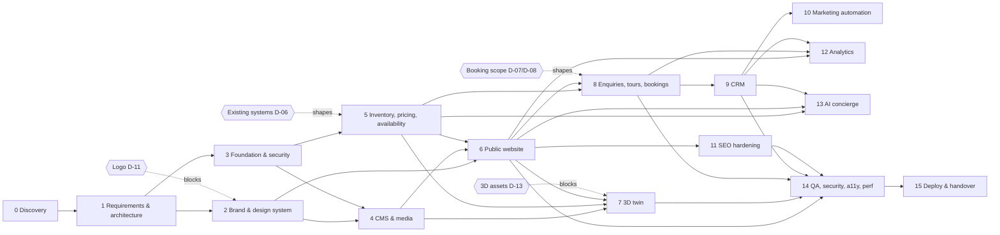

# SmartGro — Project Master Plan

> **WORK SMART. GROW TOGETHER.**
> A premium coworking and managed-workspace platform: public website, workspace discovery, real inventory, 3D digital twins, a no-code CMS, tours and bookings, CRM, marketing, SEO, analytics and (later) an AI concierge, built on one source of truth.

| | |
|---|---|
| Last updated | 2026-10-24 |
| Current phase | Phase 0: APPROVED in principle · **Phase 1: APPROVED (2026-10-24)** · **Phase 3: IN PROGRESS** · **Phase 2: IN PROGRESS** (direction sample awaiting owner sign-off) |
| Live status register | [`docs/phases/PHASE_STATUS.md`](docs/phases/PHASE_STATUS.md) |
| Decisions and risks | [`docs/decisions/DECISION_REGISTER.md`](docs/decisions/DECISION_REGISTER.md) |

**Roles in this plan**
* **Project owner:** approves phases, architecture, process and scope.
* **Client (SmartGro):** supplies business facts, policies, assets and accounts.

A recommended default never becomes a fact until its decider confirms it.

---

## 1. Governing principles

1. **One canonical record per physical workspace.** Website, 3D, booking, CRM and reports reference it. Availability and price are never copied.
2. **Physical reality ≠ marketing presentation.** Operations own the truth; Marketing owns how it is presented.
3. **No invented facts.** Locations, prices, imagery, reviews and claims come from SmartGro or are clearly marked as concepts.
4. **Phase gates.** A phase is COMPLETE only when its acceptance criteria are met, with evidence, **and** the owner approves it. Dependent work never starts on an unstable foundation.
5. **Business users never touch code, SQL, JSON, CSS or 3D coordinates** for routine work.
6. **Server-rendered, fast, accessible, secure by default.**

**Status definitions:** NOT STARTED · IN PROGRESS · BLOCKED (with the blocking decision) · READY FOR REVIEW (criteria met, awaiting owner) · APPROVED (owner sign-off) · COMPLETE (approved and handed over, with no open issues for that phase).

---

## 2. Phases

Each phase lists scope, key deliverables and **phase-level acceptance criteria (AC)**. Detailed functional acceptance criteria live in `docs/requirements/PRD.md`.

### Phase 0: Discovery, repository audit and requirements clarification
* **Deliverables:** Phase 0 report, market benchmark, decision register, risk register.
* **AC:** see `docs/phases/PHASE_0_DISCOVERY_REPORT.md` §10.

### Phase 1: Product requirements, IA, system architecture, database design, acceptance criteria
* **Deliverables:**
  * PRD
  * information architecture (sitemap and user journeys)
  * business rules
  * role and permission matrix
  * ERD
  * system architecture
  * API contracts
  * integration inventory, plus the existing-systems assessment
  * security model
  * test strategy
  * design system foundation
  * deployment plan
  * inventory import template and validation process
  * decision register
  * ADRs
* **AC (exact):**
  * **AC-1.1 Documents complete and consistent.** Every deliverable above is at v1.0 after owner review comments are resolved. All relative links resolve (link check reports 0 broken). No document contradicts another on routes, entities or rules.
  * **AC-1.2 Blocking inputs answered.** Floors per property (Q-OW-1) and D-33 (team roles) are answered, **or** explicitly deferred by the owner in the decision register with the default and the risk recorded (for floors: option P-1). (Answered on 2026-10-24: D-03, D-05, D-06, D-16, D-19, D-22, Q-OW-2…8, Q-OW-11, Q-OW-12. D-01 legal details may defer to Phase 6.)
  * **AC-1.3 Existing systems.** D-06 is answered by the client (questionnaire Q1–Q3 and Q7 at minimum), **or** the owner records an explicit deferral that accepts Scenario A as the working design and makes D-06 a Phase 5 entry gate.
  * **AC-1.4 ERD validated against reality** (*deferred to the Phase 5 entry gate by owner decision OD-30*). The first real property is supplied in the SG-INV-1.3 template (or a later version) and walked through the validation rules. Every finding is either corrected in the data or turned into an ERD change. M-1…M-6 are closed or deferred with a recorded default.
  * **AC-1.5 No silent defaults.** Every [DEFAULT] value in the PRD and business rules is confirmed by its decider or listed as "Deferred to Phase N" in the register.
  * **AC-1.6 Architecture approvals.** ADR-0003…0012 are ACCEPTED or REJECTED (D-34). The dependency list (D-24), code layout (D-25), release slicing (D-32) and import process (D-35) are approved.
  * **AC-1.7 Engineering baseline verified.** Git history is reviewed. `php artisan test --compact` passes on the local MySQL `smartgro_testing` database, including the concurrency harness. Pint is clean. *(Amended by owner decision OD-34: the push to the private remote moves to Phase 3 step 3.1.)*
  * **AC-1.8 Sign-off.** Owner approval recorded in `docs/phases/PHASE_STATUS.md`.

### Phase 2: Brand system, UX/UI design, responsive design system
* **Depends on:** Phase 1; **logo (D-11)**; photography plan (D-12).
* **Deliverables:**
  * tokens sampled from the real logo
  * type scale
  * component library
  * high-fidelity designs for home, city, centre, product, enterprise, booking/tour flows, and the back-office dashboard and key wizards
  * a mobile-first responsive specification
* **AC:**
  1. Every colour pairing in use passes WCAG 2.2 AA.
  2. Designs cover mobile (360 px) and desktop (1440 px).
  3. Every component has hover, focus, disabled, error, empty and loading states.
  4. No competitor layout or asset has been copied.
  5. The owner signs off on the visual direction.

### Phase 3: Application foundation, authentication, permissions, security, engineering standards
* **Depends on:** Phase 1 approval (D-23, D-24, D-25, D-26 resolved).
* **Step 3.1 (first):** name the GitHub organisation (D-31), create the private repository, push the history (OD-34); create a dedicated least-privileged MySQL user (R-14).
* **Deliverables:**
  * Git repo and CI
  * MySQL dev and test databases
  * Filament panel with custom theme and required MFA
  * roles and permissions per the matrix, with property scoping
  * audit log
  * security headers
  * Pest architecture tests
  * staging environment (D-14)
* **AC:**
  1. CI runs Pint, tests on MySQL, and `composer audit` / `npm audit`, all green.
  2. A policy test exists for every role × capability cell, covering both allowed and denied.
  3. MFA is enforced.
  4. Audit entries are written for every sensitive action listed in `SECURITY_MODEL.md` §7.
  5. Staging is deployed and reachable only by the team.

### Phase 4: Visual CMS, page builder, media library, publishing workflow
* **Depends on:** Phases 2 and 3.
* **Deliverables:** block library, pages and sections, navigation, profiles, media library with licensing and renditions, revisions and approvals, previews, scheduling, redirects-on-slug-change.
* **AC:**
  1. FR-CMS-1…8 pass.
  2. A Marketing Manager completes UJ-7, and a second approver completes UJ-8, unaided in a moderated test.
  3. No routine CMS task requires code, JSON or SQL.

### Phase 5: Locations, buildings, floors, spaces, inventory, pricing, availability engine
* **Depends on:** Phase 3.
* **Entry gate (owner decisions OD-30, OD-32, OD-35, D-36):** floors per property and the first property's real inventory supplied via SG-INV-1.3 and run through the validation rules (deferred AC-1.4); pricing values PR-1…PR-11 decided; the Phase 5 [DEFAULT] business values confirmed.
* **Deliverables:** inventory wizard and import, allocations, products, offerings, price plans with four-eyes approval, offers, availability service, the `SpaceAvailabilityChanged` pipeline.
* **AC:**
  1. FR-INV-1…6 pass.
  2. Unit tests exist for every BR-AV and BR-PR rule.
  3. A real location's inventory is imported successfully.
  4. Propagation completes in 60 s or less, demonstrated end to end.

### Phase 6: Public website and all customer-facing content pages
* **Depends on:** Phases 2, 4 and 5; real content (D-12, D-15).
* **Deliverables:** all IA templates, live availability and price fragments, the compare feature, forms (UI), legal pages, 404/410 pages.
* **AC:**
  1. FR-DISC-1…7 pass.
  2. NFR-PERF-1/2 are met on staging (Lighthouse CI, mobile).
  3. Axe reports no AA violations.
  4. Every page is fully server-rendered.

### Phase 7: 3D digital twin, interactive floor plans, scenes, hotspots
* **Depends on:** Phases 4, 5 and 6; assets (D-13).
* **Deliverables:** GLB validation pipeline, scene builder, Three.js viewer, 2D interactive floor plan, fallback, 360° embeds.
* **AC:**
  1. FR-3D-1…5 pass.
  2. UJ-11 is completed by a marketing user without entering any coordinates.
  3. Pages without 3D load zero 3D bytes.
  4. The pilot location scene meets NFR-PERF-4.

### Phase 8: Enquiries, tour scheduling, bookings, availability enforcement
* **Depends on:** Phases 5 and 6; CRM lead model (built minimally here and extended in Phase 9); D-07, D-08, D-10, D-28.
* **Deliverables:** forms, live tour scheduler, booking flows (scope per D-07), payments if approved, staff booking console, confirmations.
* **AC:**
  1. FR-BK-1…5 pass.
  2. Concurrency tests on MySQL prove there is no double booking or tour over-capacity.
  3. Payment webhooks are idempotent (if payments are in scope).

### Phase 9: CRM, lead qualification, assignment, pipeline, follow-up
* **Depends on:** Phase 8; D-09.
* **Deliverables:** lead inbox, de-duplication, assignment rules, SLA alerts, activities, pipeline and deals, won deal → allocation, exports.
* **AC:**
  1. FR-CRM-1…6 pass.
  2. UJ-10 is completed by a Sales/CRM Executive.
  3. Scoping is proven by tests.

### Phase 10: Marketing automation, communication integrations, offers
* **Depends on:** Phase 9; D-10; legal (D-15).
* **Deliverables:** templates, automation builder, campaigns, WhatsApp/SMS/email adapters, consent and suppression handling.
* **AC:**
  1. FR-MKT-1…3 pass.
  2. No send without valid consent or approved template (tests).
  3. Every dispatch is idempotent.

### Phase 11: Technical SEO, content SEO, structured data, search readiness
* **Depends on:** Phase 6 (SEO foundations are built into Phases 4 and 6 from the start); D-19.
* **Deliverables:** schema per template, sitemaps, robots, canonical URLs, redirect manager, 404 monitor, inventory-driven FAQs, migration redirects if an old site exists.
* **AC:**
  1. FR-SEO-1…5 pass.
  2. Zero structured-data errors on the validator for every template.
  3. Sitemaps complete.
  4. Search Console verified.

### Phase 12: Analytics, attribution, business intelligence
* **Depends on:** Phases 6, 8 and 9; D-18.
* **Deliverables:** consent-aware tagging, attribution capture, funnel/SLA/occupancy dashboards, conversion events, optional offline conversions.
* **AC:**
  1. FR-AN-1/2 pass.
  2. Dashboard figures reconcile with database queries.

### Phase 13: AI-assisted workspace discovery and concierge
* **Depends on:** Phases 5, 6 and 9 stable; D-21.
* **Deliverables:** concierge that answers only from platform data and hands off to tour or enquiry.
* **AC:**
  1. FR-AI-1 passes.
  2. Red-team tests show no invented prices or availability.

### Phase 14: Comprehensive testing, security review, accessibility, performance
* **Depends on:** all release-scoped phases.
* **Deliverables:** full regression, E2E journeys J-1…J-7, penetration test, accessibility audit, performance audit, remediation.
* **AC:**
  1. No open High/Critical security findings.
  2. WCAG 2.2 AA met.
  3. NFRs met.
  4. The owner accepts UAT.

### Phase 15: Production deployment, operational documentation, training, handover
* **Depends on:** Phase 14; D-14.
* **Deliverables:** production infrastructure, monitoring, backups with a restore drill, runbook, user guides per role, training sessions, handover.
* **AC:**
  1. Restore drill succeeds.
  2. Monitoring and alerts are live.
  3. Every role has been trained.
  4. Runbook is complete.
  5. The owner signs off on go-live.

---

## 3. Dependency map

**Parallelism:** Phases 2 and 3 can run in parallel after Phase 1. Phase 5 can start once Phase 3 is done, without waiting for Phase 2. Phase 8 builds only the minimal CRM lead model it needs; Phase 9 extends it without changing its contract.

---

## 4. Release slicing (approved 2026-10-24, D-32)

| Release | Phases | Outcome |
|---|---|---|
| **R1 Launch** | 2, 3, 4, 5, 6, 8 (tours + enquiries; bookings if D-07), 9 core, 11 essentials, 14, 15 | premium site with real inventory, live tour slots, CRM |
| R1+ (if assets ready) | 7 for pilot location(s) | 3D twin live where real scans exist |
| R2 | 10, 12, 7 rollout, booking/payments if deferred | automation, analytics, broader 3D |
| R3 | 13, member portal (D-20) | concierge and self-service |

---

## 5. Documentation map

| Document | Purpose |
|---|---|
| [`docs/phases/PHASE_STATUS.md`](docs/phases/PHASE_STATUS.md) | live phase register |
| [`docs/phases/PHASE_0_DISCOVERY_REPORT.md`](docs/phases/PHASE_0_DISCOVERY_REPORT.md) | audit, findings, decision and risk registers |
| [`docs/research/MARKET_BENCHMARK.md`](docs/research/MARKET_BENCHMARK.md) | competitor research (2026-10-24) |
| [`docs/requirements/PRD.md`](docs/requirements/PRD.md) | product requirements and NFRs |
| [`docs/requirements/INFORMATION_ARCHITECTURE.md`](docs/requirements/INFORMATION_ARCHITECTURE.md) | sitemap, page anatomy, journeys |
| [`docs/requirements/BUSINESS_RULES.md`](docs/requirements/BUSINESS_RULES.md) | numbered business rules |
| [`docs/architecture/SYSTEM_ARCHITECTURE.md`](docs/architecture/SYSTEM_ARCHITECTURE.md) | modules, boundaries, API, propagation, 3D pipeline |
| [`docs/architecture/DATABASE_ERD.md`](docs/architecture/DATABASE_ERD.md) | preliminary data model |
| [`docs/architecture/INTEGRATION_CONTRACTS.md`](docs/architecture/INTEGRATION_CONTRACTS.md) | integrations and domain events |
| [`docs/design/DESIGN_SYSTEM.md`](docs/design/DESIGN_SYSTEM.md) | design principles, provisional tokens, contrast analysis |
| [`docs/security/SECURITY_MODEL.md`](docs/security/SECURITY_MODEL.md) | threat model, auth, role matrix, controls |
| [`docs/testing/TEST_STRATEGY.md`](docs/testing/TEST_STRATEGY.md) | test layers, MySQL strategy, critical journeys |
| [`docs/operations/DEPLOYMENT_RUNBOOK.md`](docs/operations/DEPLOYMENT_RUNBOOK.md) | environments, requirements, release procedure (draft) |
| [`docs/decisions/ADR_INDEX.md`](docs/decisions/ADR_INDEX.md) | architecture decisions |
| [`docs/decisions/DECISION_REGISTER.md`](docs/decisions/DECISION_REGISTER.md) | confirmed owner decisions (§0), owner questions, all decisions and risks classified; owner actions |
| [`docs/research/EXISTING_WEBSITE_AUDIT.md`](docs/research/EXISTING_WEBSITE_AUDIT.md) | existing smartgro.space site: URL inventory, redirect plan, compromise finding |
| [`docs/phases/PHASE_1_PROGRESS_REPORT.md`](docs/phases/PHASE_1_PROGRESS_REPORT.md) | Phase 1 progress report (2026-10-24) |
| [`docs/requirements/CLIENT_INPUTS_REQUIRED.md`](docs/requirements/CLIENT_INPUTS_REQUIRED.md) | checklist of business facts and assets needed from the client |
| [`docs/requirements/PRICING_CONFIGURATION_PROPOSAL.md`](docs/requirements/PRICING_CONFIGURATION_PROPOSAL.md) | pricing configuration proposal (option P-2; no prices set) |
| [`docs/requirements/INVENTORY_IMPORT_SPEC.md`](docs/requirements/INVENTORY_IMPORT_SPEC.md) | inventory import template SG-INV-1.3 and validation rules |
| [`docs/architecture/API_CONTRACTS.md`](docs/architecture/API_CONTRACTS.md) | public API, form, webhook and domain-action contracts |
| [`docs/architecture/EXISTING_SYSTEMS_ASSESSMENT.md`](docs/architecture/EXISTING_SYSTEMS_ASSESSMENT.md) | D-06 questionnaire, scenarios, source-of-truth recommendation |
| [`docs/operations/LOCAL_DEVELOPMENT.md`](docs/operations/LOCAL_DEVELOPMENT.md) | local MySQL setup, tests, Git and GitHub remote steps |
