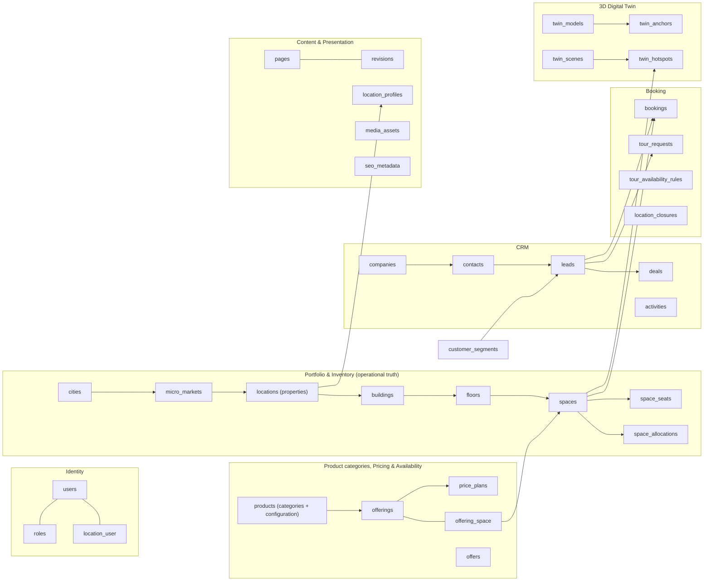
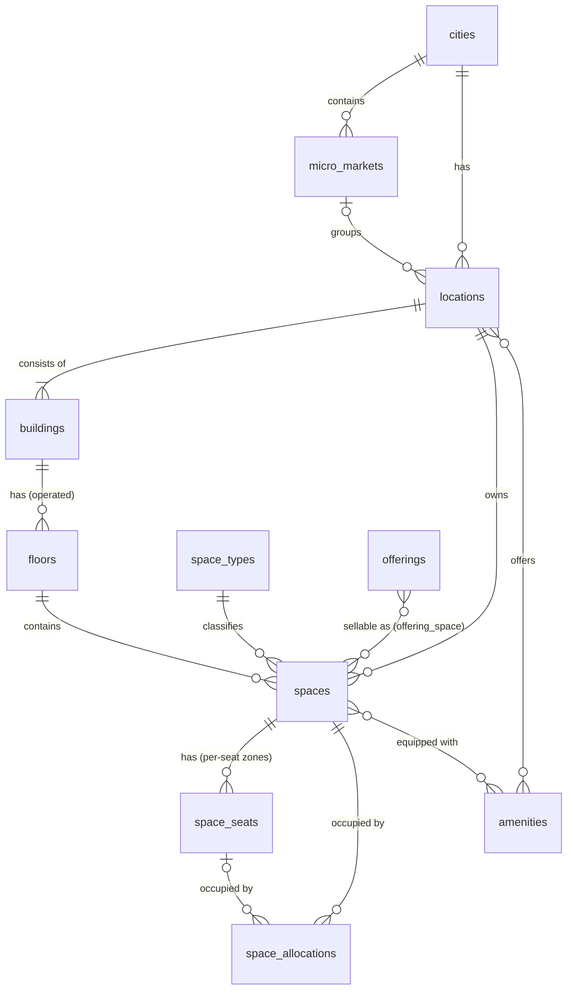
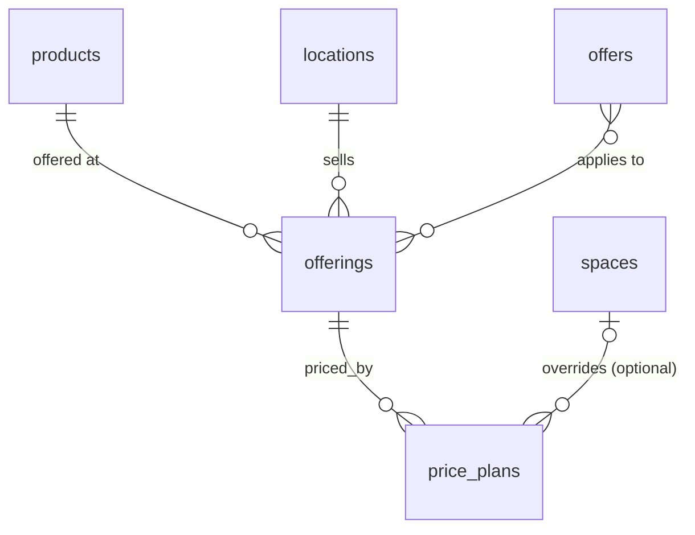
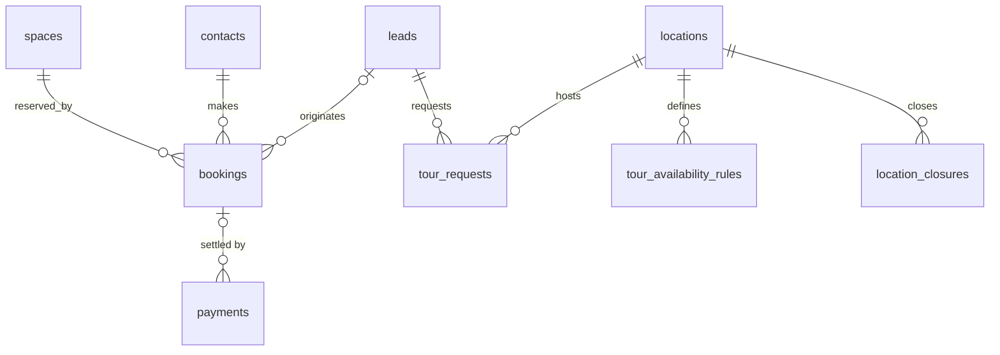
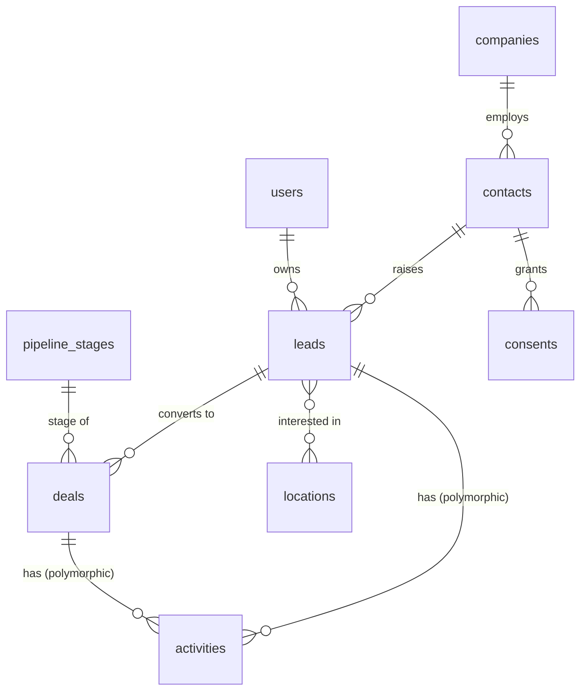
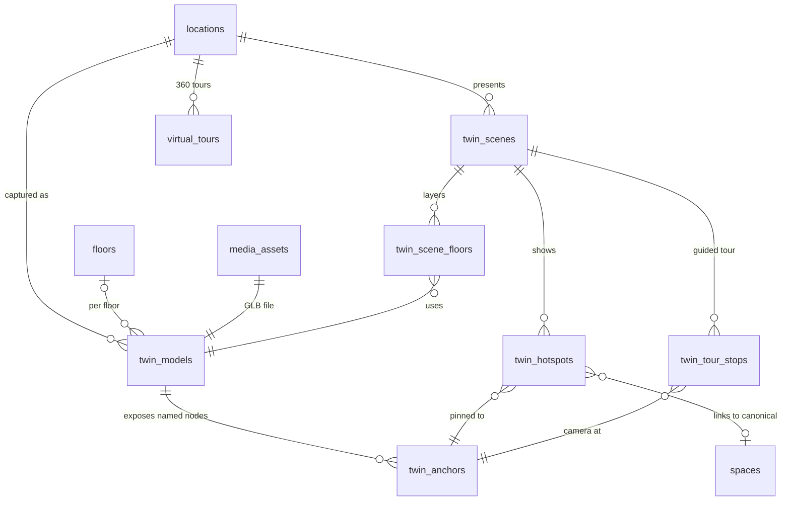

# SmartGro — Database ERD (Preliminary)

| | |
|---|---|
| Status | **v1.1-rc — Phase 1, ready for owner review.** Incorporates the owner decisions of 2026-10-24 (round 2; change log §12). Not yet validated against real inventory. |
| Last updated | 2026-10-24 |
| Target engine | MySQL 8.4 (ADR-0002 accepted; test suite verified on 8.4.11) |
| Confirmed inputs | OD-07 product categories, OD-08 four Noida properties (10 floors in total, **allocation unknown**), OD-09 owned and leased operating models, OD-10 individual/pooled/hybrid inventory, OD-06 no existing systems, OD-05 English only (`../decisions/DECISION_REGISTER.md` §0) |
| Still open | floor allocation and full addresses (Q-OW-1), property ↔ building grouping (Q-OW-2), pricing configuration (brief §9 not received, Q-OW-9), M-1…M-6 (§11) |

This is the **preliminary** entity model. It is detailed enough to validate the architecture and the business rules. It becomes v1.0 after the first real property's inventory is run through the import template (`../requirements/INVENTORY_IMPORT_SPEC.md`) and the open items above are closed. **Nothing here has been implemented, and no real property, floor or space data has been created.**

### Glossary

| Business term (owner) | System entity | Meaning |
|---|---|---|
| **Property** | `locations` row | A SmartGro-operated workspace site that customers can visit, e.g. the site at "A-70, Sector 2, Noida". Renaming the entity to `properties` is proposed (Q-OW-8). Public URLs keep the customer-friendly word "locations". |
| Building | `buildings` row | A physical building belonging to exactly one property. A single-building property has one building, created automatically; the admin UI then hides the building level. |
| Floor | `floors` row | A floor SmartGro operates inside a building |
| Space | `spaces` row | A canonical physical workspace: a cabin, desk zone, room or suite |
| Seat | `space_seats` row | An individually tracked desk inside a desk zone |
| Product category | `products` row | What is sold, e.g. "Dedicated desks" (admin-managed; §4) |
| Offering | `offerings` row | A product category available at a property; the unit of property-specific pricing |

---

## 1. Modelling principles

1. **One canonical record per physical workspace.** `spaces` is the only place a physical room, office, desk zone or seat exists. Website listings, 3D hotspots, bookings, CRM proposals and reports all reference `spaces.id`.
2. **Physical reality and marketing presentation live in different tables.**
   * Physical / operational (owned by Operations): `buildings`, `locations`, `floors`, `spaces`, `space_seats`, `space_allocations`, `bookings`, `price_plans`, `location_closures`.
   * Presentation (owned by Marketing): `location_profiles`, `offerings` copy, `media_assets`, `seo_metadata`, `pages`, and so on.
   * Presentation tables **never** store availability, capacity or price. They reference them.
3. **Availability is derived, never typed in.** It is computed from `spaces.operational_status`, `space_allocations`, `bookings` (including unexpired holds) and `location_closures`. A cached projection (`space_availability_snapshots`) may exist for speed, but it is rebuilt from those tables and is never edited by hand.
4. **Money is stored as integer minor units** (`amount_minor`, BIGINT UNSIGNED, paise for INR) plus a `currency` CHAR(3). There are no floats.
5. **Time is stored in UTC.** Each `location` carries a `timezone`, defaulting to `Asia/Kolkata` pending D-01.
6. **Public references are not sequential IDs.** Customer-visible records (leads, bookings, tours) carry a unique `reference` such as `SG-BK-7F3K9Q`, so internal IDs are never enumerable.
7. **Enumerations are PHP backed enums** stored as `VARCHAR` with application validation. Native MySQL `ENUM` is avoided so adding a value never needs a table rebuild.
8. **Soft deletes only where history matters** (locations, spaces, content). Bookings, allocations and audit logs are never deleted: they are cancelled or ended.
9. Laravel conventions apply: plural snake_case tables, `id` BIGINT PK, `*_id` FKs with constraints, and `created_at`/`updated_at`.

---

## 2. Domain map

---

## 3. Portfolio & inventory (operational truth)

| Table | Purpose | Key columns | Constraints and indexes |
|---|---|---|---|
| `cities` | Market city. Initial target markets per OD-03: Noida (operating), Gurgaon, Delhi, Faridabad, Ghaziabad (target only). | `name`, `slug`, `state`, `country_code`, `is_target_market`. "Operating" is **derived** (≥ 1 open property), never typed. | unique `slug` |
| `micro_markets` | Business district or sector within a city (e.g. "Sector 62"; Indian search behaviour) | `city_id`, `name`, `slug` | unique (`city_id`, `slug`) |
| `locations` (**properties**) | A SmartGro-operated property: the operational and marketed unit | `city_id`, `micro_market_id`, `code`, `name`, `slug`, `timezone`, **`operating_model`** (`owned_operated`, `leased_operated`; required, OD-09), `operational_status` (`planned`, `pre_opening`, `open`, `temporarily_closed`, `closed`), `opens_on`, `operating_hours` (structured), `centre_manager_id`, `primary_building_id`, `external_system`, `external_ref` | unique `code`; unique (`city_id`, `slug`); unique (`external_system`, `external_ref`) |
| `property_leases` | **Proposed (Q-OW-3):** internal lease facts for `leased_operated` properties. Restricted to Super Admin, Ops Manager and Finance. | `location_id`, `building_id` (nullable: the lease may cover one building), `lease_starts_on`, `lease_ends_on`, `lock_in_ends_on`, `notice_period_months`, `landlord_reference` (no personal data) | index (`location_id`, `lease_ends_on`) |
| `buildings` | A physical building belonging to **one** property. Each property has ≥ 1 building. The address lives here because a property can span buildings (Q-OW-2). | `location_id`, `code`, `name` (nullable), `address_line_1` (e.g. "A-70"), `address_line_2`, `locality` (e.g. "Sector 2"), `postal_code` (nullable until supplied), `city_id`, `state`, `country_code`, `latitude`, `longitude`, `is_primary`, `certifications` (only if documented) | unique `code`; exactly one `is_primary` per property (enforced in the domain action) |
| `floors` | A floor SmartGro operates inside a building | `building_id`, `location_id` (denormalised, kept consistent by the action), `building_level` (int), `label`, `sort_order`, `floor_plan_asset_id` | unique (`building_id`, `building_level`) |
| `space_types` | **Admin-managed** physical classification (replaces the hard-coded enum) | `name`, `key`, `default_inventory_mode`, `allowed_inventory_modes` (subset of §3.2), `is_bookable_by_time` | unique `key` |
| `spaces` | **Canonical workspace record** | `location_id`, `floor_id`, `space_type_id`, `code` (unique, permanent), `name`, **`inventory_mode`** (§3.2), `capacity_seats`, `area_sqft`, `operational_status` (`active`, `maintenance`, `out_of_service`, `decommissioned`), `is_publicly_listable` (ops-controlled), `turnaround_minutes`, `min_booking_minutes`, `max_booking_minutes`, `external_system`, `external_ref` | unique `code`; index (`location_id`, `space_type_id`, `operational_status`); check `capacity_seats > 0` |
| `space_seats` | Individual seats in a `per_seat` zone | `space_id`, `label`, `is_active` | unique (`space_id`, `label`) |
| `offering_space` | **Which product categories a space can be sold as** (replaces `spaces.offering_id`). One physical room can be sold both as a meeting room (hourly) and as a training room (daily). Availability stays on the space, so any use blocks every other use. | `offering_id`, `space_id` | composite PK; the offering's property must equal the space's property |
| `space_allocations` | Long-term occupancy (agreements, licences, reservations) | `space_id`, `space_seat_id` (nullable), `company_id`, `deal_id`, `agreement_reference` (internal, groups multi-space agreements such as managed offices), `seats_allocated`, `starts_on`, `ends_on` (nullable = open-ended), `notice_given_on`, `status` (`reserved`, `active`, `notice_period`, `ended`, `cancelled`), `source` (`manual`, `import`, `integration`), `external_ref` | index (`space_id`, `status`, `starts_on`, `ends_on`); index `agreement_reference` |
| `amenities` | Controlled vocabulary (e.g. "Video-conference screen", "Shower") | `name`, `slug`, `category`, `icon_key` | unique `slug` |
| `amenity_location`, `amenity_space` | Pivots | | composite PK |
| `inventory_imports` | One uploaded SG-INV workbook and its lifecycle (ADR-0012) | `uploaded_by`, `file_path` (private), `file_sha256`, `template_id`, `status` (`uploaded` → `validating` → `invalid`/`valid` → `awaiting_approval` → `approved` → `committing` → `committed`, or `rejected`/`failed`), `summary`, `warnings_acknowledged_by/at`, `approved_by/at`, `committed_at`, `environment` | index (`status`, `created_at`); `approved_by` ≠ `uploaded_by` enforced in the action |
| `inventory_import_issues` | Validation findings | `inventory_import_id`, `sheet`, `row`, `column`, `rule`, `severity`, `message`, `value_excerpt` (truncated, personal data masked) | index (`inventory_import_id`, `severity`) |

### 3.1 Initial `space_types` (admin-managed reference data, aligned to the owner's seven categories)

| Key | Name | Default inventory mode | Typically sellable as (OD-07) |
|---|---|---|---|
| `private_cabin` | Private cabin / office | `exclusive` | Private cabins / private offices; part of a managed office |
| `desk_zone_dedicated` | Dedicated desk zone | `per_seat` | Dedicated desks |
| `desk_zone_flexible` | Flexible seating zone | `pooled` | Hot desks / flexible seating |
| `meeting_room` | Meeting room | `exclusive` | Meeting rooms |
| `conference_training_room` | Conference / training room | `exclusive` | Conference and training rooms (and meeting rooms, if the owner allows) |
| `office_suite` | Office suite / floor plate | `exclusive` | Managed offices for enterprises; private offices |

These are seed values, not facts about any property. Administrators can add types. Phone booths, event spaces and similar types are **not** seeded, because the owner has not listed them.

A **virtual office / business address has no physical space.** It is a product category whose configuration says "no inventory" (§4).

### 3.2 Inventory modes (OD-10)

| `inventory_mode` | Meaning | Availability unit | Lock row (ADR-0004) |
|---|---|---|---|
| `exclusive` | the whole space is used by one customer or agreement at a time (cabin, room, suite) | the space | the space row |
| `per_seat` | **individual tracking:** each seat in the zone has its own status | each `space_seats` row | the **zone's** space row (never seat rows alone) |
| `pooled` | **pooled capacity:** bookings draw from `capacity_seats` | count of seats in use vs. capacity | the zone's space row |

**Hybrid** (OD-10 C) is supported **within a property**: one property can contain `exclusive`, `per_seat` and `pooled` spaces side by side, each enforcing its own rule. A *hybrid zone* (some seats individually assigned and the remainder pooled, inside one zone) is an additional option, **not adopted** pending Q-OW-7. If adopted, it adds the mode `per_seat_with_pool` with pool capacity = active seats − individually committed seats, using the same zone lock.

---

## 4. Products, offerings, pricing and offers

| Table | Purpose | Key columns |
|---|---|---|
| `products` | **Admin-managed product category** with its configuration (OD-07). Seeded with the owner's seven categories. Rules are edited through typed admin forms, never raw JSON. | see §4.1 |
| `offerings` | A product category **available at a property**. This is the unit customers browse and the unit of **property-specific pricing** (OD-08). | `product_id`, `location_id`, `is_active` (ops), `public_price_display` (`hidden`, `from_price`, `exact`; requires pricing permission), optional per-property overrides of §4.1 rules, unique (`product_id`, `location_id`) |
| `cancellation_policies` | Named, admin-managed policies referenced by product categories or offerings. **Values deferred** (D-07, brief §9). | `name`, `summary` (customer-facing), `free_cancellation_until_minutes`, `refund_percent_after`, `is_active` |
| `price_plans` | Operational price truth | `offering_id`, `space_id` (nullable override), `unit` (`per_seat_month`, `per_space_month`, `per_hour`, `per_half_day`, `per_day`, `per_month_service`), `amount_minor`, `currency`, `tax_treatment` (`exclusive`, `inclusive`; D-04), `min_term_months`, `security_deposit_months`, `valid_from`, `valid_to`, `status` (`draft`, `pending_approval`, `active`, `retired`), `approved_by`, `approved_at` |
| `offers` | Promotions | `name`, `code` (nullable), `discount_type` (`percent`, `fixed`, `free_period`), `value`, `starts_at`, `ends_at`, `max_redemptions`, `status` (`draft`, `pending_approval`, `active`, `expired`), `terms`, `approved_by` |
| `offer_offering` | Eligibility pivot | |

**Rule:** at most one `active` price plan per (`offering_id`, `space_id`, `unit`) for any instant. This is enforced in a domain service inside a transaction, because MySQL has no exclusion constraints.

**Pricing configuration is incomplete:** section 9 of the owner's brief ("Pricing configuration") was not received (Q-OW-9). The `price_plans` model above is retained unchanged until it arrives.

### 4.1 Product category configuration (`products`)

Each category may differ in pricing, availability, booking workflow, capacity, approval, payment, cancellation, duration and required customer information (brief §5). The configuration is modelled as typed columns and small reference tables:

| Setting | Column(s) | Allowed values | Notes |
|---|---|---|---|
| Identity | `name`, `slug`, `description`, `sort_order`, `is_active`, `is_publicly_listed` | — | |
| Inventory requirement | `inventory_requirement` | `physical_space`, `none` | `none` = virtual office / business address |
| Compatible space types and modes | `product_space_type` pivot; `allowed_inventory_modes` | `exclusive`, `per_seat`, `pooled` | e.g. Dedicated desks → `per_seat`; Hot desks → `pooled` |
| Fulfilment pattern | `fulfilment` | `term_agreement` (monthly/term), `time_slot` (hourly/half-day/day), `day_pass`, `service_subscription` | determines whether availability is consumed by allocations or by bookings |
| Duration options | `allowed_durations`, `min_duration`, `max_duration` | `hourly`, `half_day`, `daily`, `monthly`, `term_months` | stored as validated enum lists; edited as checkboxes |
| Acquisition workflow | `acquisition_workflow` | `enquiry_quote`, `request_then_approve`, `instant_booking` | `instant_booking` is only selectable once D-07/D-08 permit it |
| Approval | `requires_staff_approval`, `approver_role` | boolean, role | |
| Payment rule | `payment_rule` | `none`, `deposit`, `full_prepayment`, `invoice` | **values deferred** (brief §9, D-08) |
| Cancellation | `cancellation_policy_id` | FK | values deferred |
| Capacity rules | `min_seats_per_order`, `max_seats_per_order` | integers | |
| Booking window | `min_notice_minutes`, `max_advance_days` | integers | BR-BK-7 defaults are not approved values |
| Required customer information | `product_required_fields` pivot | `company_name`, `gstin`, `team_size`, `move_in_date`, `attendee_count`, `business_documents`, `billing_address` | e.g. virtual office → `business_documents` |
| Segment relevance | `product_customer_segment` pivot | the eight segments (§6) | used for discovery and marketing, **not** for priority |

**Seed categories** (names from OD-07; every rule value is a *proposed default* until confirmed, per `../decisions/DECISION_REGISTER.md`):

| Category | inventory_requirement | Typical fulfilment | Default inventory mode | Default workflow (proposed) |
|---|---|---|---|---|
| Private cabins / private offices | physical_space | term_agreement | exclusive | enquiry_quote |
| Dedicated desks | physical_space | term_agreement | per_seat | enquiry_quote |
| Hot desks / flexible seating | physical_space | day_pass and/or term_agreement | pooled | request_then_approve (instant once permitted) |
| Meeting rooms | physical_space | time_slot | exclusive | request_then_approve (instant once permitted) |
| Conference and training rooms | physical_space | time_slot | exclusive | request_then_approve |
| Virtual office / business address | none | service_subscription | — | enquiry_quote (document checks) |
| Managed offices for enterprises | physical_space (one or many spaces) | term_agreement | exclusive | enquiry_quote |

---

## 5. Bookings, holds, tours and closures

| Table | Purpose | Key columns | Notes |
|---|---|---|---|
| `bookings` | Time-bound reservation of a space (meeting room, conference/training room, day pass) | `reference`, `offering_id` (the category sold), `space_id`, `space_seat_id` (`per_seat` only), `contact_id`, `company_id`, `lead_id`, `starts_at`, `ends_at`, `quantity` (seats, `pooled` only), `status` (`held`, `pending_payment`, `confirmed`, `cancelled`, `completed`, `no_show`), `hold_expires_at`, `price_snapshot` (JSON: plan id, unit, amount, tax, offer), `channel` (`web`, `admin`, `sales`), `cancelled_reason`, `idempotency_key`, `external_system`, `external_ref` (nullable; only if an external booking engine is master, D-06) | unique `reference`; unique `idempotency_key`; index (`space_id`, `status`, `starts_at`, `ends_at`); check `ends_at > starts_at` |
| `payments` | Gateway transactions (Phase 8, only if D-07/D-08 approve online payment) | `booking_id`, `gateway`, `gateway_order_id`, `gateway_payment_id`, `amount_minor`, `currency`, `status`, `raw_status`, `paid_at` | unique (`gateway`, `gateway_payment_id`) |
| `tour_requests` | Site-visit scheduling | `reference`, `lead_id`, `location_id`, `scheduled_start_at`, `duration_minutes`, `status` (`requested`, `confirmed`, `rescheduled`, `completed`, `no_show`, `cancelled`), `host_user_id`, `visitor_count`, `notes` | index (`location_id`, `scheduled_start_at`) |
| `tour_availability_rules` | When tours can happen | `location_id`, `weekday`, `start_time`, `end_time`, `slot_minutes`, `max_concurrent_tours` | |
| `location_closures` | Holidays and closures (block bookings and tours) | `location_id`, `starts_at`, `ends_at`, `reason`, `is_public` | |

**Double-booking prevention:** see `BUSINESS_RULES.md` §4 and ADR-0004. Every create, extend, confirm or cancel runs inside `DB::transaction(..., attempts: 3)`.
* Its **first statements** take `lockForUpdate()` on the inventory lock rows from §3.2: the space row for `exclusive`, and the **zone's** space row for `per_seat` and `pooled`.
* When several spaces are involved (a managed-office agreement, or a booking that combines rooms), all rows are locked **in ascending `id` order**.
* Only then does it read and re-check overlap and capacity, and write.
* Unexpired holds count as occupied. Cancellation releases inventory immediately, because availability is derived.

**`bookings` per mode:** `space_id` always references the space. `space_seat_id` (nullable) is set for `per_seat` bookings. `quantity` is used for `pooled` bookings.

---

## 6. CRM

| Table | Key columns | Notes |
|---|---|---|
| `companies` | `name`, `domain`, `gstin` (nullable, validated format), `industry`, `size_band` | |
| `contacts` | `company_id`, `first_name`, `last_name`, `email`, `phone_e164`, `whatsapp_opt_in`, `preferred_channel` | index `email`; index `phone_e164`; dedupe on email OR phone |
| `leads` | `reference`, `contact_id`, `company_id`, `source` (`website_form`, `tour_form`, `phone`, `whatsapp`, `walk_in`, `broker`, `referral`, `event`, `import`), `status` (`new`, `contacted`, `qualified`, `tour_scheduled`, `proposal_sent`, `won`, `lost`, `disqualified`), `product_id`, `seats_min`, `seats_max`, `move_in_by`, `budget_min_minor`, `budget_max_minor`, `city_id`, `owner_user_id`, `score`, `first_responded_at`, `lost_reason`, attribution (`utm_source`, `utm_medium`, `utm_campaign`, `utm_term`, `utm_content`, `gclid`, `fbclid`, `landing_url`, `referrer_url`), `consent_snapshot` (JSON) | index (`status`, `owner_user_id`); index `created_at` |
| `lead_location` | pivot of properties of interest | |
| `customer_segments` | **Admin-managed** list seeded with the owner's eight segments (OD-04): startups and small businesses; freelancers and independent professionals; SMEs and growing companies; large enterprises and corporates; remote and hybrid employees; consultants and business travellers; companies seeking managed offices; businesses requiring virtual offices / registered addresses. `marketing_priority` stays empty until the owner sets priorities. | `name`, `slug`, `sort_order`, `marketing_priority` (nullable), `is_active` |
| `leads.customer_segment_id`, `companies.customer_segment_id` | Optional self-identified segment ("Which best describes you?"), used for routing and reporting | nullable FK |
| `pipeline_stages` | `name`, `sort_order`, `probability_pct`, `is_won`, `is_lost` | configurable by Sales Manager |
| `deals` | `lead_id`, `company_id`, `pipeline_stage_id`, `owner_user_id`, `seats`, `monthly_value_minor`, `expected_close_on`, `lost_reason` | |
| `deal_space` | proposed spaces (references canonical `spaces`) | |
| `activities` | `subject_type`, `subject_id`, `type` (`call`, `email`, `whatsapp`, `meeting`, `note`, `task`), `user_id`, `due_at`, `completed_at`, `body`, `outcome` | index (`subject_type`, `subject_id`) |
| `assignment_rules` | `name`, `priority`, `criteria` (UI-built: city, location, product, seats band, source), `strategy` (`round_robin`, `fixed_user`, `least_loaded`), `user_ids`, `is_active` | |
| `consents` | `contact_id`, `purpose` (`service_communication`, `marketing_email`, `marketing_whatsapp`, `marketing_sms`), `granted_at`, `withdrawn_at`, `source`, `notice_version`, `ip_hash` | append-only |

---

## 7. Content, media and SEO (presentation)

| Table | Key columns | Notes |
|---|---|---|
| `pages` | `title`, `slug`, `template` (`standard`, `landing`, `legal`), `blocks` (JSON, built with the Filament Builder, never hand-edited), `status` (`draft`, `in_review`, `approved`, `published`, `archived`), `published_revision_id`, `published_at` | unique `slug` |
| `revisions` | `revisionable_type`, `revisionable_id`, `number`, `payload` (JSON), `state` (`draft`, `submitted`, `approved`, `rejected`, `published`, `superseded`), `author_id`, `reviewer_id`, `review_note`, `submitted_at`, `reviewed_at`, `published_at` | polymorphic, used by pages, posts, location profiles, offerings copy and scenes (ADR-0005) |
| `reusable_sections` | `name`, `blocks` (JSON), `status` | referenced by page blocks |
| `navigation_menus` / `navigation_items` | `menu_id`, `parent_id`, `label`, `link_type` (`page`, `location`, `offering`, `post`, `external`), `linkable_type/id`, `url`, `sort_order` | links resolve by ID, so slug changes do not break menus |
| `location_profiles` | `location_id` (unique), `headline`, `summary`, `body_blocks`, `getting_there`, `hero_asset_id`, `is_visible`, `status` | marketing face of a location; never stores availability or price |
| `offering_profiles` | `offering_id` (unique), `headline`, `description`, `highlights`, `status` | |
| `posts`, `post_categories` | blog / insights | |
| `faqs` | `question`, `answer`, `scope_type/id` (global, location, product), `sort_order`, `status` | |
| `testimonials` | `quote`, `person_name`, `person_title`, `company_name`, `consent_on_file` (required true to publish), `location_id` | |
| `case_studies` | `title`, `slug`, `company_name`, `blocks`, `consent_on_file`, `status` | |
| `media_assets` | `kind` (`photo`, `video`, `document`, `floor_plan`, `model_3d`, `panorama_360`), `title`, `alt_text`, `caption`, `focal_point_x/y` (0–1), `origin` (`client_photography`, `commissioned`, `licensed_stock`, `ai_generated_concept`, `render`), `depicts_location_id` (nullable), `is_real_location_capture` (derived: true only for client/commissioned photography and real scans of that location), `licence_type`, `licence_holder`, `licence_reference`, `licence_expires_at`, `credit_line`, `usage_restrictions`, `uploaded_by` | file storage via `spatie/laravel-medialibrary` (proposed, ADR-0006) |
| `mediables` | `media_asset_id`, `mediable_type/id`, `collection` (`gallery`, `hero`, `floor_plan`), `sort_order` | |
| `seo_metadata` | `seoable_type/id`, `meta_title`, `meta_description`, `canonical_url`, `robots`, `og_asset_id`, `schema_overrides` (UI-built) | |
| `redirects` | `from_path`, **`match_type`** (`exact`, `prefix`), `to_path` (nullable for 410), `status_code` (301, 302, 410), `hits`, `last_hit_at`, `created_by` | unique (`from_path`, `match_type`). Prefix matching is needed for `/pin/*` → 410 (`../research/EXISTING_WEBSITE_AUDIT.md`). |
| `site_settings` | `group`, `key`, `value` (typed JSON) | brand tokens, contact numbers, tracking IDs (not secrets). **Brand group** references media assets: `logo_primary` (original SVG retained + optimised web rendition), `logo_reversed`, `logo_mark`, `favicon`. Every template reads the logo from these settings; it is never hard-coded. |

---

## 8. 3D digital twin

The design goal is that **business users never handle coordinates.** A trained 3D technician names nodes in the GLB using a convention: `SG_SPACE_<space code>`, `SG_AMENITY_<slug>` and `SG_CAM_<n>`. On upload, a queued validation job extracts those nodes into `twin_anchors`. Marketing users then link anchors to canonical spaces from a dropdown, with automatic suggestions when the node name matches a `spaces.code`.

| Table | Key columns |
|---|---|
| `twin_models` | `location_id`, `floor_id`, `media_asset_id`, `capture_type` (`measured_scan`, `architectural_model`, `conceptual_model`), `captured_on`, `captured_by`, `file_bytes`, `triangle_count`, `validation_status` (`pending`, `passed`, `failed`), `validation_report` (JSON), `version` |
| `twin_anchors` | `twin_model_id`, `node_name`, `anchor_type` (`space`, `amenity`, `camera`), `suggested_space_id` |
| `twin_scenes` | `location_id`, `name`, `status` (publishable, revisioned), `default_floor_id`, `disclaimer_mode` (auto: shows "Conceptual model, not a scan" when any layer is `conceptual_model`) |
| `twin_scene_floors` | `twin_scene_id`, `floor_id`, `twin_model_id`, `sort_order` |
| `twin_hotspots` | `twin_scene_id`, `twin_anchor_id`, `space_id` (nullable), `amenity_id` (nullable), `label_override`, `is_visible` |
| `twin_tour_stops` | `twin_scene_id`, `twin_anchor_id` (camera), `title`, `narration`, `sort_order` |
| `virtual_tours` | `location_id`, `provider` (allow-listed), `embed_url`, `captured_on`, `is_real_capture` |

Hotspot state (available, occupied, maintenance) is **never stored** on hotspots. The viewer fetches it live from the availability endpoint by `space_id`.

---

## 9. Marketing, communications and integrations

| Table | Key columns |
|---|---|
| `campaigns` | `name`, `channel_mix`, `starts_at`, `ends_at`, `budget_minor`, `utm_campaign`, `status` |
| `message_templates` | `channel` (`email`, `whatsapp`, `sms`), `name`, `locale`, `subject`, `body` (merge tags from a fixed list), `provider_template_id` (WhatsApp/SMS-DLT IDs), `status` (`draft`, `approved_internal`, `provider_approved`, `rejected`) |
| `automation_rules` | `name`, `trigger` (domain event key), `conditions` (UI-built), `actions` (UI-built: send template, assign, create task, wait), `is_active`, `approved_by` |
| `automation_runs` | `automation_rule_id`, `subject_type/id`, `status`, `step`, `next_run_at` |
| `message_dispatches` | `channel`, `template_id`, `contact_id`, `idempotency_key` (unique), `provider_message_id`, `status`, `error`, `sent_at`, `delivered_at` |
| `suppressions` | `channel`, `address_hash`, `reason` |
| `webhook_receipts` | `provider`, `external_event_id`, `signature_valid`, `payload`, `processed_at`; unique (`provider`, `external_event_id`) for idempotency |

---

## 10. Identity, access and audit

| Table | Notes |
|---|---|
| `users` | existing Laravel table, extended with `is_active`, `last_login_at`, plus MFA columns per Filament 5 MFA |
| `roles`, `permissions`, `model_has_roles`, … | `spatie/laravel-permission` 8.x (proposed; Packagist shows Laravel 13 support, verified 2026-10-24) |
| `location_user` | scopes centre managers, sales executives and front-desk staff to their locations |
| `activity_log` | `spatie/laravel-activitylog` 5.x (proposed) for the audit trail: who, what, before/after, IP, user agent |

---

## 11. Open modelling questions

A "recommended default" is **not** an approved fact (see `../decisions/DECISION_REGISTER.md`).

| # | Question | Status (2026-10-24) | Recommended default |
|---|---|---|---|
| M-1 | Can a property span more than one building? | **Modelled:** property 1—n buildings (supports both answers). Whether A-70 and A-71 Sector 2 form one property or two is **open (Q-OW-2)**. | — |
| M-2 | Per-seat vs pooled desks | **Resolved (OD-10):** both, configurable per space, mixed within a property | — |
| M-3 | Does an existing system own operational data? | **Resolved (OD-06):** none. SmartGro is master (Scenario A). `external_*` columns are kept for future integrations. | — |
| M-4 | Prices tax-inclusive or exclusive on the website? | Deferred to Phase 5 (brief §9 pending) | store exclusive, show "+ GST" |
| M-5 | Multi-currency or multi-country? | **Resolved (OD-02):** India only at launch; INR | — |
| M-6 | Multi-language content? | **Resolved (OD-05):** English only. No translation tables. | — |
| M-7 | How are the 10 floors allocated across the four properties, and at which building levels? | **Requires owner input (Q-OW-1).** Floors are **not** distributed by assumption. | — |
| M-8 | Can the operating model differ within a property (per building or floor)? | **Requires owner input (Q-OW-3)** | property-level `operating_model`; a lease can be scoped to a building |
| M-9 | Are hybrid *zones* (assigned seats plus a pool in one zone) needed? | **Requires owner input (Q-OW-7)** | not adopted; hybrid is supported across spaces within a property |
| M-10 | Rename the entity `locations` → `properties`? | **Requires owner approval (Q-OW-8)** | rename before Phase 5 (no code exists yet) |

---

## 12. Change log

| Version | Date | Change | Driver |
|---|---|---|---|
| v1.0-rc | 2026-10-24 | first complete preliminary model | Phase 1 |
| v1.1-rc | 2026-10-24 | **C-1** hierarchy corrected: property (`locations`) 1—n `buildings` 1—n `floors` (was: building hosts locations). Addresses moved to buildings with `locality` and nullable `postal_code`. | OD-08, brief §6 |
| | | **C-2** `locations.operating_model` (owned/leased); optional restricted `property_leases` (proposed) | OD-09 |
| | | **C-3** `cities.is_target_market`; operating status derived | OD-03 |
| | | **C-4** admin-managed `space_types` replaces the enum; seed list aligned to the seven categories (board room, event space and phone booth removed) | OD-07 |
| | | **C-5** `spaces.inventory_mode` (`exclusive` / `per_seat` / `pooled`) replaces `booking_mode`; fulfilment moved to product configuration | OD-10 |
| | | **C-6** `offering_space` many-to-many replaces `spaces.offering_id` | brief §5 (one room sold as several products) |
| | | **C-7** product category configuration (§4.1), `cancellation_policies` | brief §5 |
| | | **C-8** `space_allocations.agreement_reference` for multi-space agreements | managed offices |
| | | **C-9** `bookings.space_seat_id`, `bookings.offering_id` | per-seat bookings; multi-product rooms |
| | | **C-10** `customer_segments` + segment links | OD-04 |
| | | **C-11** brand logo settings | OD-01 |
| | | **C-12** `redirects.match_type` (prefix) | existing-site audit |
| | | Locking targets for every inventory mode, with ascending-id ordering for multi-space operations | ADR-0004 (invariant unchanged) |
