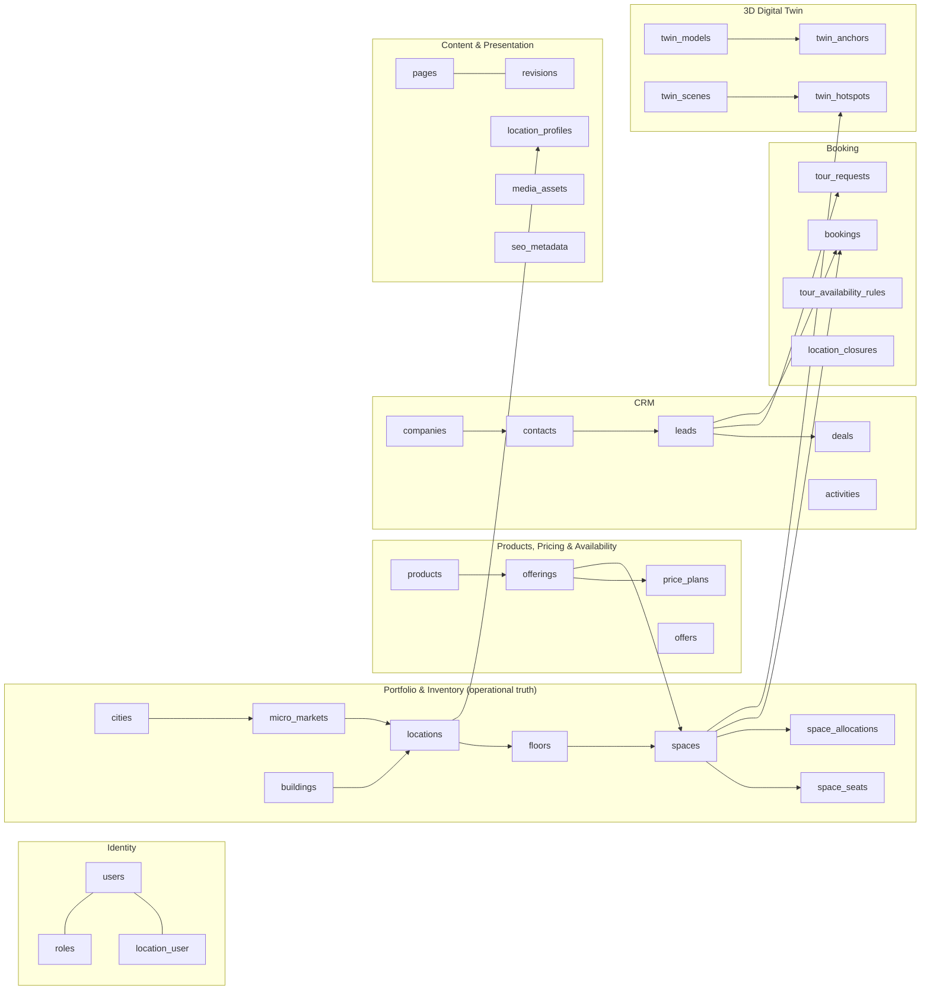
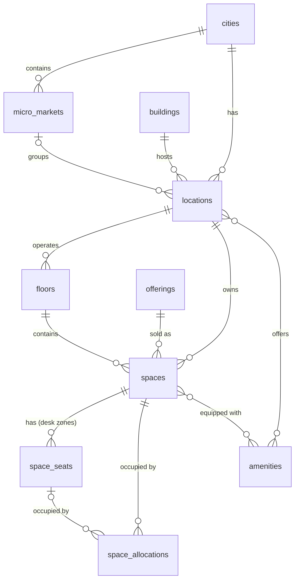
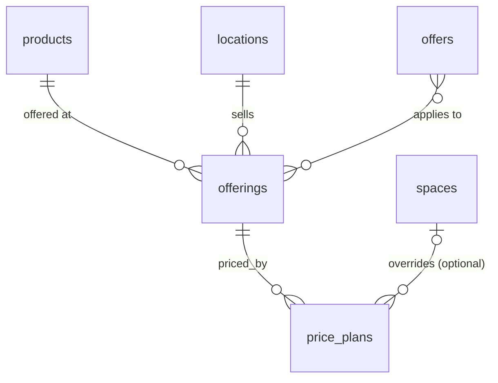
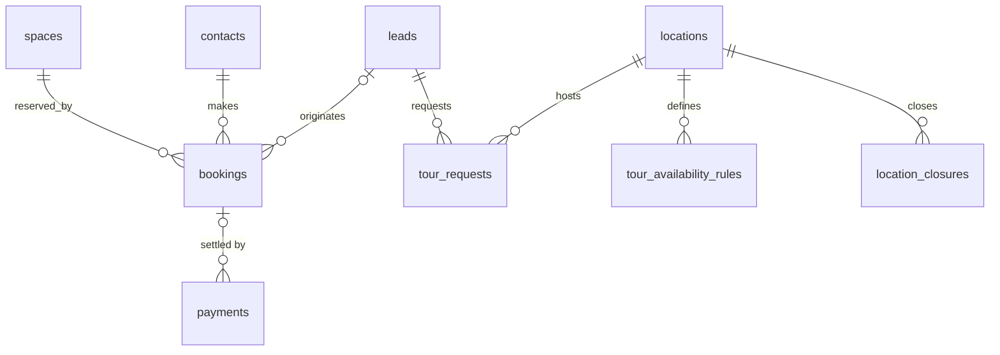
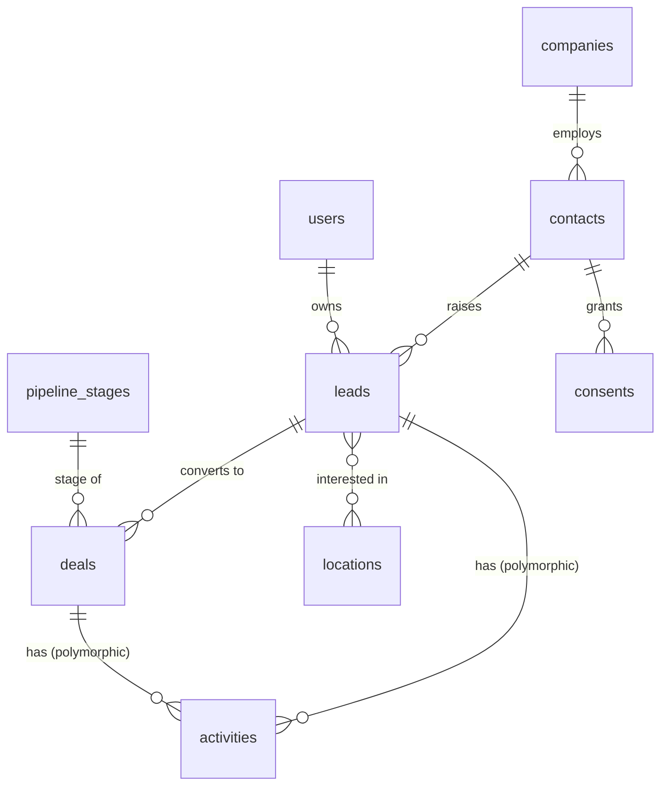
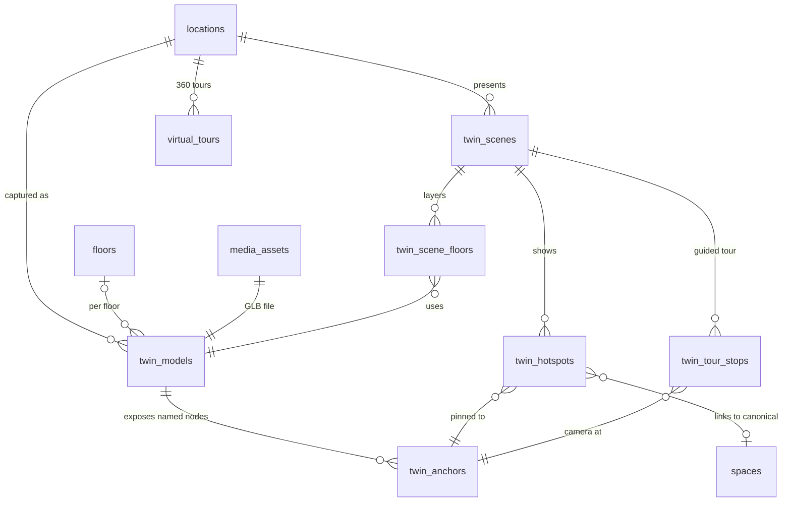

# SmartGro — Database ERD (Preliminary)

| | |
|---|---|
| Status | **v1.0-rc — Phase 1, ready for owner review; not yet validated against real inventory** |
| Last updated | 2026-10-24 |
| Target engine | MySQL 8.4 (ADR-0002 accepted; test suite verified on 8.4.11) |
| Depends on decisions | D-03 product catalogue, D-04 pricing rules (Phase 5), D-05 inventory granularity, D-06 existing systems ([assessment](EXISTING_SYSTEMS_ASSESSMENT.md)), D-16 languages |

This is the **preliminary** entity model. It is detailed enough to validate the architecture and the business rules. It becomes v1.0 only after the client's first real location is run through the SG-INV-1.0 template (`../requirements/INVENTORY_IMPORT_SPEC.md`) and M-1…M-6 (§11) are closed. Nothing here has been implemented.

---

## 1. Modelling principles

1. **One canonical record per physical workspace.** `spaces` is the only place a physical room, office, desk zone or seat exists. Website listings, 3D hotspots, bookings, CRM proposals and reports all reference `spaces.id`.
2. **Physical reality and marketing presentation live in different tables.**
   * Physical / operational (owned by Operations): `buildings`, `locations`, `floors`, `spaces`, `space_seats`, `space_allocations`, `bookings`, `price_plans`, `location_closures`.
   * Presentation (owned by Marketing): `location_profiles`, `offerings` copy, `media_assets`, `seo_metadata`, `pages`, and so on.
   * Presentation tables **never** store availability, capacity or price. They reference them.
3. **Availability is derived, never typed in.** It is computed from `spaces.operational_status`, `space_allocations`, `bookings` (including unexpired holds) and `location_closures`. A cached projection (`space_availability_snapshots`) may exist for speed, but it is rebuilt from those tables and is never edited by hand.
4. **Money is stored as integer minor units** (`amount_minor`, BIGINT UNSIGNED, paise for INR) plus a `currency` CHAR(3). There are no floats.
5. **Time is stored in UTC.** Each `location` carries a `timezone`, defaulting to `Asia/Kolkata` pending D-01.
6. **Public references are not sequential IDs.** Customer-visible records (leads, bookings, tours) carry a unique `reference` such as `SG-BK-7F3K9Q`, so internal IDs are never enumerable.
7. **Enumerations are PHP backed enums** stored as `VARCHAR` with application validation. Native MySQL `ENUM` is avoided so adding a value never needs a table rebuild.
8. **Soft deletes only where history matters** (locations, spaces, content). Bookings, allocations and audit logs are never deleted: they are cancelled or ended.
9. Laravel conventions apply: plural snake_case tables, `id` BIGINT PK, `*_id` FKs with constraints, and `created_at`/`updated_at`.

---

## 2. Domain map

---

## 3. Portfolio & inventory (operational truth)

| Table | Purpose | Key columns | Constraints and indexes |
|---|---|---|---|
| `cities` | Market city | `name`, `slug`, `state`, `country_code`, `is_active` | unique `slug` |
| `micro_markets` | Business district within a city (Indian search behaviour; see research) | `city_id`, `name`, `slug` | unique (`city_id`, `slug`) |
| `buildings` | The physical building | `name`, `address_line_1/2`, `postal_code`, `city_id`, `latitude`, `longitude`, `landlord_name`, `certifications` (JSON list, e.g. LEED/IGBC, only if documented) | index `city_id` |
| `locations` | A SmartGro-operated centre (operational unit) | `building_id`, `city_id`, `micro_market_id`, `code` (e.g. `BLR-KOR`), `name`, `slug`, `timezone`, `operational_status` (`planned`, `pre_opening`, `open`, `temporarily_closed`, `closed`), `opens_on`, `operating_hours` (structured), `centre_manager_id`, `external_system`, `external_ref` (nullable; D-06) | unique `code`; unique (`city_id`, `slug`); unique (`external_system`, `external_ref`) |
| `floors` | A floor SmartGro operates in the building | `location_id`, `building_level` (int), `label`, `sort_order`, `floor_plan_asset_id` | unique (`location_id`, `building_level`) |
| `spaces` | **Canonical workspace record** | `location_id`, `floor_id`, `offering_id` (nullable), `code` (unique human ref, e.g. `BLR-KOR-03-PO-12`), `name`, `space_type` (enum, §3.1), `booking_mode` (`contract`, `exclusive_slot`, `shared_capacity`), `capacity_seats`, `area_sqft`, `operational_status` (`active`, `maintenance`, `out_of_service`, `decommissioned`), `is_publicly_listable` (ops-controlled), `turnaround_minutes`, `min_booking_minutes`, `max_booking_minutes`, `external_system`, `external_ref` (nullable; D-06) | unique `code`; unique (`external_system`, `external_ref`); index (`location_id`, `space_type`, `operational_status`); check `capacity_seats > 0` |
| `space_seats` | Individual seats inside a desk zone (only if D-05 = per-seat tracking) | `space_id`, `label`, `is_active` | unique (`space_id`, `label`) |
| `space_allocations` | Long-term occupancy (contracts, licences, reservations) | `space_id`, `space_seat_id` (nullable), `company_id`, `deal_id` (nullable), `seats_allocated`, `starts_on`, `ends_on` (nullable = open-ended), `notice_given_on`, `status` (`reserved`, `active`, `notice_period`, `ended`, `cancelled`), `source` (`manual`, `import`, `integration`), `external_ref` | index (`space_id`, `status`, `starts_on`, `ends_on`) |
| `amenities` | Controlled vocabulary (e.g. "Video-conference screen", "Shower") | `name`, `slug`, `category`, `icon_key` | unique `slug` |
| `amenity_location`, `amenity_space` | Pivots | | composite PK |
| `inventory_imports` | One uploaded SG-INV workbook and its lifecycle (ADR-0012) | `uploaded_by`, `file_path` (private), `file_sha256`, `template_id`, `status` (`uploaded` → `validating` → `invalid`/`valid` → `awaiting_approval` → `approved` → `committing` → `committed`, or `rejected`/`failed`), `summary`, `warnings_acknowledged_by/at`, `approved_by/at`, `committed_at`, `environment` | index (`status`, `created_at`); `approved_by` ≠ `uploaded_by` enforced in the action |
| `inventory_import_issues` | Validation findings | `inventory_import_id`, `sheet`, `row`, `column`, `rule`, `severity`, `message`, `value_excerpt` (truncated, personal data masked) | index (`inventory_import_id`, `severity`) |

### 3.1 `space_type` (initial list, to confirm under D-03)
`private_office`, `managed_suite`, `dedicated_desk_zone`, `hot_desk_zone`, `meeting_room`, `board_room`, `event_space`, `phone_booth`, `training_room`.

A **virtual office is not a space.** It is an `offering` with no physical inventory.

---

## 4. Products, offerings, pricing and offers

| Table | Purpose | Key columns |
|---|---|---|
| `products` | Catalogue definition, for example "Private Office" | `name`, `slug`, `kind` (`physical`, `service`), `default_space_types` (JSON), `is_active` |
| `offerings` | A product **available at a location**. This is the unit customers browse ("Private offices at Koramangala"). | `product_id`, `location_id`, `is_active` (ops), `public_price_display` (`hidden`, `from_price`, `exact`; **requires pricing permission**), unique (`product_id`, `location_id`) |
| `price_plans` | Operational price truth | `offering_id`, `space_id` (nullable override), `unit` (`per_seat_month`, `per_space_month`, `per_hour`, `per_half_day`, `per_day`, `per_month_service`), `amount_minor`, `currency`, `tax_treatment` (`exclusive`, `inclusive`; D-04), `min_term_months`, `security_deposit_months`, `valid_from`, `valid_to`, `status` (`draft`, `pending_approval`, `active`, `retired`), `approved_by`, `approved_at` |
| `offers` | Promotions | `name`, `code` (nullable), `discount_type` (`percent`, `fixed`, `free_period`), `value`, `starts_at`, `ends_at`, `max_redemptions`, `status` (`draft`, `pending_approval`, `active`, `expired`), `terms`, `approved_by` |
| `offer_offering` | Eligibility pivot | |

**Rule:** at most one `active` price plan per (`offering_id`, `space_id`, `unit`) for any instant. This is enforced in a domain service inside a transaction, because MySQL has no exclusion constraints.

---

## 5. Bookings, holds, tours and closures

| Table | Purpose | Key columns | Notes |
|---|---|---|---|
| `bookings` | Time-bound reservation of a space (meeting room, day pass, event) | `reference`, `space_id`, `contact_id`, `company_id`, `lead_id`, `starts_at`, `ends_at`, `quantity` (seats, for `shared_capacity`), `status` (`held`, `pending_payment`, `confirmed`, `cancelled`, `completed`, `no_show`), `hold_expires_at`, `price_snapshot` (JSON: plan id, unit, amount, tax, offer), `channel` (`web`, `admin`, `sales`), `cancelled_reason`, `idempotency_key`, `external_system`, `external_ref` (nullable; only if an external booking engine is master, D-06) | unique `reference`; unique `idempotency_key`; index (`space_id`, `status`, `starts_at`, `ends_at`); check `ends_at > starts_at` |
| `payments` | Gateway transactions (Phase 8, only if D-07/D-08 approve online payment) | `booking_id`, `gateway`, `gateway_order_id`, `gateway_payment_id`, `amount_minor`, `currency`, `status`, `raw_status`, `paid_at` | unique (`gateway`, `gateway_payment_id`) |
| `tour_requests` | Site-visit scheduling | `reference`, `lead_id`, `location_id`, `scheduled_start_at`, `duration_minutes`, `status` (`requested`, `confirmed`, `rescheduled`, `completed`, `no_show`, `cancelled`), `host_user_id`, `visitor_count`, `notes` | index (`location_id`, `scheduled_start_at`) |
| `tour_availability_rules` | When tours can happen | `location_id`, `weekday`, `start_time`, `end_time`, `slot_minutes`, `max_concurrent_tours` | |
| `location_closures` | Holidays and closures (block bookings and tours) | `location_id`, `starts_at`, `ends_at`, `reason`, `is_public` | |

**Double-booking prevention:** see `BUSINESS_RULES.md` §4 and ADR-0004. In short, every create, extend or confirm runs inside `DB::transaction(..., attempts: 3)`, takes `lockForUpdate()` on the parent `spaces` row, re-checks overlap and capacity, then writes. Unexpired holds count as occupied.

---

## 6. CRM

| Table | Key columns | Notes |
|---|---|---|
| `companies` | `name`, `domain`, `gstin` (nullable, validated format), `industry`, `size_band` | |
| `contacts` | `company_id`, `first_name`, `last_name`, `email`, `phone_e164`, `whatsapp_opt_in`, `preferred_channel` | index `email`; index `phone_e164`; dedupe on email OR phone |
| `leads` | `reference`, `contact_id`, `company_id`, `source` (`website_form`, `tour_form`, `phone`, `whatsapp`, `walk_in`, `broker`, `referral`, `event`, `import`), `status` (`new`, `contacted`, `qualified`, `tour_scheduled`, `proposal_sent`, `won`, `lost`, `disqualified`), `product_id`, `seats_min`, `seats_max`, `move_in_by`, `budget_min_minor`, `budget_max_minor`, `city_id`, `owner_user_id`, `score`, `first_responded_at`, `lost_reason`, attribution (`utm_source`, `utm_medium`, `utm_campaign`, `utm_term`, `utm_content`, `gclid`, `fbclid`, `landing_url`, `referrer_url`), `consent_snapshot` (JSON) | index (`status`, `owner_user_id`); index `created_at` |
| `lead_location` | pivot of locations of interest | |
| `pipeline_stages` | `name`, `sort_order`, `probability_pct`, `is_won`, `is_lost` | configurable by Sales Manager |
| `deals` | `lead_id`, `company_id`, `pipeline_stage_id`, `owner_user_id`, `seats`, `monthly_value_minor`, `expected_close_on`, `lost_reason` | |
| `deal_space` | proposed spaces (references canonical `spaces`) | |
| `activities` | `subject_type`, `subject_id`, `type` (`call`, `email`, `whatsapp`, `meeting`, `note`, `task`), `user_id`, `due_at`, `completed_at`, `body`, `outcome` | index (`subject_type`, `subject_id`) |
| `assignment_rules` | `name`, `priority`, `criteria` (UI-built: city, location, product, seats band, source), `strategy` (`round_robin`, `fixed_user`, `least_loaded`), `user_ids`, `is_active` | |
| `consents` | `contact_id`, `purpose` (`service_communication`, `marketing_email`, `marketing_whatsapp`, `marketing_sms`), `granted_at`, `withdrawn_at`, `source`, `notice_version`, `ip_hash` | append-only |

---

## 7. Content, media and SEO (presentation)

| Table | Key columns | Notes |
|---|---|---|
| `pages` | `title`, `slug`, `template` (`standard`, `landing`, `legal`), `blocks` (JSON, built with the Filament Builder, never hand-edited), `status` (`draft`, `in_review`, `approved`, `published`, `archived`), `published_revision_id`, `published_at` | unique `slug` |
| `revisions` | `revisionable_type`, `revisionable_id`, `number`, `payload` (JSON), `state` (`draft`, `submitted`, `approved`, `rejected`, `published`, `superseded`), `author_id`, `reviewer_id`, `review_note`, `submitted_at`, `reviewed_at`, `published_at` | polymorphic, used by pages, posts, location profiles, offerings copy and scenes (ADR-0005) |
| `reusable_sections` | `name`, `blocks` (JSON), `status` | referenced by page blocks |
| `navigation_menus` / `navigation_items` | `menu_id`, `parent_id`, `label`, `link_type` (`page`, `location`, `offering`, `post`, `external`), `linkable_type/id`, `url`, `sort_order` | links resolve by ID, so slug changes do not break menus |
| `location_profiles` | `location_id` (unique), `headline`, `summary`, `body_blocks`, `getting_there`, `hero_asset_id`, `is_visible`, `status` | marketing face of a location; never stores availability or price |
| `offering_profiles` | `offering_id` (unique), `headline`, `description`, `highlights`, `status` | |
| `posts`, `post_categories` | blog / insights | |
| `faqs` | `question`, `answer`, `scope_type/id` (global, location, product), `sort_order`, `status` | |
| `testimonials` | `quote`, `person_name`, `person_title`, `company_name`, `consent_on_file` (required true to publish), `location_id` | |
| `case_studies` | `title`, `slug`, `company_name`, `blocks`, `consent_on_file`, `status` | |
| `media_assets` | `kind` (`photo`, `video`, `document`, `floor_plan`, `model_3d`, `panorama_360`), `title`, `alt_text`, `caption`, `focal_point_x/y` (0–1), `origin` (`client_photography`, `commissioned`, `licensed_stock`, `ai_generated_concept`, `render`), `depicts_location_id` (nullable), `is_real_location_capture` (derived: true only for client/commissioned photography and real scans of that location), `licence_type`, `licence_holder`, `licence_reference`, `licence_expires_at`, `credit_line`, `usage_restrictions`, `uploaded_by` | file storage via `spatie/laravel-medialibrary` (proposed, ADR-0006) |
| `mediables` | `media_asset_id`, `mediable_type/id`, `collection` (`gallery`, `hero`, `floor_plan`), `sort_order` | |
| `seo_metadata` | `seoable_type/id`, `meta_title`, `meta_description`, `canonical_url`, `robots`, `og_asset_id`, `schema_overrides` (UI-built) | |
| `redirects` | `from_path` (unique), `to_path`, `status_code` (301, 302, 410), `hits`, `last_hit_at`, `created_by` | |
| `site_settings` | `group`, `key`, `value` (typed JSON) | brand tokens, contact numbers, tracking IDs (not secrets) |

---

## 8. 3D digital twin

The design goal is that **business users never handle coordinates.** A trained 3D technician names nodes in the GLB using a convention: `SG_SPACE_<space code>`, `SG_AMENITY_<slug>` and `SG_CAM_<n>`. On upload, a queued validation job extracts those nodes into `twin_anchors`. Marketing users then link anchors to canonical spaces from a dropdown, with automatic suggestions when the node name matches a `spaces.code`.

| Table | Key columns |
|---|---|
| `twin_models` | `location_id`, `floor_id`, `media_asset_id`, `capture_type` (`measured_scan`, `architectural_model`, `conceptual_model`), `captured_on`, `captured_by`, `file_bytes`, `triangle_count`, `validation_status` (`pending`, `passed`, `failed`), `validation_report` (JSON), `version` |
| `twin_anchors` | `twin_model_id`, `node_name`, `anchor_type` (`space`, `amenity`, `camera`), `suggested_space_id` |
| `twin_scenes` | `location_id`, `name`, `status` (publishable, revisioned), `default_floor_id`, `disclaimer_mode` (auto: shows "Conceptual model, not a scan" when any layer is `conceptual_model`) |
| `twin_scene_floors` | `twin_scene_id`, `floor_id`, `twin_model_id`, `sort_order` |
| `twin_hotspots` | `twin_scene_id`, `twin_anchor_id`, `space_id` (nullable), `amenity_id` (nullable), `label_override`, `is_visible` |
| `twin_tour_stops` | `twin_scene_id`, `twin_anchor_id` (camera), `title`, `narration`, `sort_order` |
| `virtual_tours` | `location_id`, `provider` (allow-listed), `embed_url`, `captured_on`, `is_real_capture` |

Hotspot state (available, occupied, maintenance) is **never stored** on hotspots. The viewer fetches it live from the availability endpoint by `space_id`.

---

## 9. Marketing, communications and integrations

| Table | Key columns |
|---|---|
| `campaigns` | `name`, `channel_mix`, `starts_at`, `ends_at`, `budget_minor`, `utm_campaign`, `status` |
| `message_templates` | `channel` (`email`, `whatsapp`, `sms`), `name`, `locale`, `subject`, `body` (merge tags from a fixed list), `provider_template_id` (WhatsApp/SMS-DLT IDs), `status` (`draft`, `approved_internal`, `provider_approved`, `rejected`) |
| `automation_rules` | `name`, `trigger` (domain event key), `conditions` (UI-built), `actions` (UI-built: send template, assign, create task, wait), `is_active`, `approved_by` |
| `automation_runs` | `automation_rule_id`, `subject_type/id`, `status`, `step`, `next_run_at` |
| `message_dispatches` | `channel`, `template_id`, `contact_id`, `idempotency_key` (unique), `provider_message_id`, `status`, `error`, `sent_at`, `delivered_at` |
| `suppressions` | `channel`, `address_hash`, `reason` |
| `webhook_receipts` | `provider`, `external_event_id`, `signature_valid`, `payload`, `processed_at`; unique (`provider`, `external_event_id`) for idempotency |

---

## 10. Identity, access and audit

| Table | Notes |
|---|---|
| `users` | existing Laravel table, extended with `is_active`, `last_login_at`, plus MFA columns per Filament 5 MFA |
| `roles`, `permissions`, `model_has_roles`, … | `spatie/laravel-permission` 8.x (proposed; Packagist shows Laravel 13 support, verified 2026-10-24) |
| `location_user` | scopes centre managers, sales executives and front-desk staff to their locations |
| `activity_log` | `spatie/laravel-activitylog` 5.x (proposed) for the audit trail: who, what, before/after, IP, user agent |

---

## 11. Open modelling questions

None of these is answered yet. The "recommended default" column is **not** an approved fact (see `../decisions/DECISION_REGISTER.md`).

| # | Question | Decision | Classification | Recommended default |
|---|---|---|---|---|
| M-1 | Can one SmartGro location span more than one building? | CLIENT_INPUTS C-2.4 | Requires client input | No. One building per location; one building may host several locations. |
| M-2 | Are dedicated desks sold and tracked per seat? | D-05 | Requires client input | Yes: `space_seats` for dedicated-desk zones; hot desks are pooled capacity. |
| M-3 | Does an existing system own any operational data? | D-06 ([assessment](EXISTING_SYSTEMS_ASSESSMENT.md)) | Requires client input | Scenario A: SmartGro is master. If not, `spaces`/`space_allocations` become a mirror via `external_system` + `external_ref`, with the sync design in the assessment §5. |
| M-4 | Prices tax-inclusive or tax-exclusive on the website? | D-04 | Deferred to Phase 5 | Store exclusive, display "+ GST". |
| M-5 | Multi-currency or multi-country? | D-01 | Requires client input | INR only; the schema keeps `currency` so it can extend later. |
| M-6 | Multi-language content? | D-16 | Requires client input | English only. No translation tables; revisit before the Phase 4 build. |
