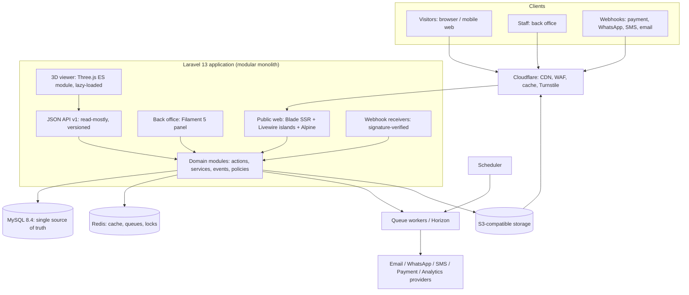
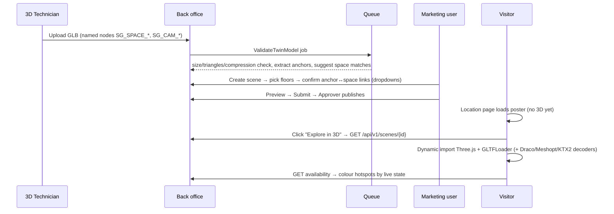

# SmartGro — System Architecture

| | |
|---|---|
| Status | **v1.0-rc — Phase 1, ready for owner review.** ADR-0001 (modular monolith) and ADR-0002 (MySQL) accepted 2026-10-24. Other ADRs PROPOSED. |
| Last updated | 2026-10-24 |
| Related | `DATABASE_ERD.md` · `API_CONTRACTS.md` · `INTEGRATION_CONTRACTS.md` · `EXISTING_SYSTEMS_ASSESSMENT.md` · `../decisions/ADR_INDEX.md` · `../decisions/DECISION_REGISTER.md` · `../requirements/BUSINESS_RULES.md` |

---

## 1. Verified starting point (2026-10-24)

Facts observed in the repository and on the development machine. See the Phase 0 report for commands and evidence.

| Item | Observed | Target | Gap |
|---|---|---|---|
| PHP | 8.5.4 CLI, OPcache | 8.5 | — |
| Laravel | 13.38.0 (fresh skeleton) | 13 | — |
| Filament | 5.10.3 installed, **no panel configured** | 5 | Panel and theme to create (Phase 3) |
| Livewire | 4.4.8 (Filament dependency) | where appropriate | — |
| Alpine.js | bundled inside Livewire's JS; no separate npm package | yes | Use Livewire's bundled Alpine (ADR-0008) |
| Tailwind CSS | 4.3.3 via `@tailwindcss/vite`; Vite 8.3.5 | yes | — |
| Pest | 5.3.3; 9 tests (2 examples + 7 MySQL concurrency harness), passing on MySQL 8.4.11 | yes | — |
| Database | **Tests forced to MySQL** (`smartgro_testing`) with a `*_testing` guard. `.env.example` describes MySQL with placeholders. The local dev `.env` stays on SQLite until the owner runs the setup script (action A-1), which creates the DBs and user and writes credentials only to `.env`. | MySQL 8.4 | Owner action A-1 |
| Redis | **Not installed**; `phpredis` extension **not loaded**; `predis` not installed | Redis | Install server + `php8.5-redis`, or use `predis` (ADR-0007) |
| Object storage | `league/flysystem-aws-s3-v3` **not installed**; AWS keys empty | S3-compatible | Add adapter at Phase 4 (dependency approval) |
| Three.js | not installed (npm latest `three@0.186.1`, checked 2026-10-24) | yes | Add at Phase 7 |
| Version control | **Git initialised 2026-10-24** on `main` (reviewed baseline + small commits). No remote yet. | Git + private GitHub | Remote: D-31 / action A-2 |
| Spreadsheet reading | `openspout/openspout` 4.32.0 and `league/csv` 9.28.0 present as Filament dependencies | XLSX import (ADR-0012) | Declare openspout as a direct dependency (D-24) |
| Image processing | `gd` and `imagick` extensions loaded | yes | — |

All candidate packages listed in §9 publish constraints compatible with Laravel 13 and PHP 8.5, according to Packagist metadata retrieved 2026-10-24. **None has been installed.** Adding dependencies requires owner approval (D-24).

---

## 2. Architectural style

**Modular monolith (ADR-0001).** It is a single Laravel application and a single MySQL database, with explicit module boundaries enforced by convention, policies and Pest architecture tests. There are no microservices: the workload (a marketing site, a back office and moderate booking volume) does not justify them, and one transactional database is what makes the single-source-of-truth and anti-double-booking guarantees simple and safe.



---

## 3. Modules and ownership

| Module | Owns (writes) | Reads from | Primary roles |
|---|---|---|---|
| **Identity & Access** | users, roles, permissions, location scopes, audit log | — | Platform Admin |
| **Portfolio & Inventory** | cities, micro-markets, properties (`locations`), buildings, floors, space types, spaces, seats, amenities, allocations, closures, lease facts | Identity | Operations, Centre Manager |
| **Commerce** | product categories and their configuration, offerings (incl. space eligibility), price plans, offers, cancellation policies | Inventory | Finance, Operations |
| **Availability** (service, no own tables except the optional snapshot) | `space_availability_snapshots` (derived) | Inventory, Commerce, Booking | system |
| **Booking** | bookings, holds, payments, tour requests, tour rules | Inventory, Availability, CRM | Front desk, Sales |
| **CRM** | contacts, companies, leads, deals, activities, assignment rules, consents | Inventory (read-only), Booking | Sales |
| **Content & Media** | pages, revisions, sections, navigation, profiles, posts, FAQs, testimonials, case studies, media assets, site settings | Inventory and Commerce (read-only) | Marketing, Editors |
| **SEO** | seo metadata, redirects, sitemap generation | Content, Inventory | SEO Specialist |
| **Digital Twin** | twin models, anchors, scenes, hotspots, tour stops, 360 tours | Inventory, Availability (read-only), Media | 3D Technician, Marketing |
| **Marketing Automation** | campaigns, templates, automation rules and runs, dispatches, suppressions | CRM, Booking (events) | Marketing |
| **Analytics** | attribution, conversion events, report definitions | all (read-only) | Analyst, Management |
| **Integrations** | provider adapters, webhook receipts | — | Platform Admin |
| **Concierge (Phase 13)** | conversation logs | Inventory, Availability, Content (read-only) | — |

**Boundary rules**

1. A module writes only to the tables it owns. Cross-module changes go through the owning module's **action classes** (e.g. `Booking\ConfirmBooking`, `Inventory\AllocateSpace`) or through domain events.
2. Content and marketing modules have **read-only** access to inventory and pricing. This is enforced by policies (runtime) and by Pest `arch()` tests (build time).
3. Domain events are the integration seam: `SpaceAvailabilityChanged`, `PricePlanActivated`, `LeadCreated`, `LeadAssigned`, `TourScheduled`, `BookingConfirmed`, `BookingCancelled`, `ContentPublished`, `ConsentWithdrawn`.

### 3.1 Proposed code layout (requires approval, D-25)

The layout stays inside Laravel's standard directories (CLAUDE.md asks that no new base folders be added without approval). Domains appear as **sub-namespaces**:

```
app/
  Actions/{Inventory,Booking,Crm,Content,Twin,Marketing}/   # one class per business operation
  Enums/{Inventory,Booking,Crm,Content}/                    # backed enums (statuses, types)
  Events/{...}/  Listeners/{...}/  Jobs/{...}/
  Filament/Clusters/{Website,Workspaces,Sales,Marketing,Insights,Settings}/
  Http/Controllers/Web/      # public SSR pages
  Http/Controllers/Api/V1/   # JSON API
  Http/Controllers/Webhooks/
  Http/Requests/             # Form Requests
  Livewire/                  # public interactive islands (filters, booking, tour scheduler)
  Models/                    # Eloquent models (flat, Laravel default)
  Policies/
  Services/{Availability,Pricing,Integrations}/   # only where an action is not enough
resources/
  views/{layouts,components,pages,partials}/
  js/viewer/                 # Three.js viewer (dynamically imported)
tests/
  Feature/{Inventory,Booking,...}/
  Unit/
  Arch/                      # module boundary rules
```

---

## 4. Request surfaces and API boundaries

| Surface | Technology | Auth | Caching |
|---|---|---|---|
| Public pages (`/`, `/locations/...`, `/workspaces/...`, `/insights/...`) | Blade, server-rendered | none | HTML cacheable at the CDN, tag-purged on publish and availability change |
| Public interactive islands (search filters, tour scheduler, booking flow, enquiry forms) | Livewire 4 components | CSRF, rate limits, Turnstile/honeypot | not cached |
| JSON API `/api/v1/*` | Laravel controllers + Eloquent API Resources | public read endpoints are rate-limited; write endpoints are not exposed at launch | short TTL (≤ 60 s) for availability |
| Back office `/admin` (path TBC) | Filament 5 panel with custom theme | session + **required MFA** + role permissions | none |
| Webhooks `/webhooks/{provider}` | controllers | provider signature verification | none |

**Initial API v1 endpoints (read-only).** Full request/response contracts are in [`API_CONTRACTS.md`](API_CONTRACTS.md).

| Endpoint | Used by | Returns |
|---|---|---|
| `GET /api/v1/locations/{city}/{location}/availability?date=` | location page widget, 3D viewer | per-space public availability state (BR-AV-1), no counts |
| `GET /api/v1/spaces/{code}/slots?date=` | meeting-room booking UI (only if D-07) | open slots |
| `GET /api/v1/locations/{city}/{location}/tour-slots?from=&to=` | tour scheduler | open tour slots |
| `GET /api/v1/locations/{city}/{location}/scene` | 3D viewer | scene manifest: model URLs (CDN), floors, hotspots → space codes, tour stops, disclaimer |

No database IDs are exposed: locations are identified by slug, spaces by permanent code, and customer records by random reference.

Forms (enquiry, tour, booking) are submitted through Livewire actions backed by Form Request–equivalent validation, not through a public write API. A write API is only added if a mobile app or a partner integration requires one (versioned, token-authenticated with Sanctum).

---

## 5. Availability propagation (single source of truth in practice)

1. An operational change (allocation, booking, status change or closure) is committed in a transaction.
2. After commit (`afterCommit` listeners), the system emits `SpaceAvailabilityChanged(space_id)`.
3. Listeners:
   * rebuild that space's row in `space_availability_snapshots` (optional read model),
   * purge cache tags `location:{id}` and `space:{id}` in the application cache,
   * queue a CDN purge for affected URLs (location page, offering pages, city page),
   * notify CRM watchers (e.g. deals that proposed that space).
4. Public HTML shows availability through a **live fragment** (Livewire island or API call), so a stale CDN page can never show stale availability. The page shell is cacheable; the availability is not.

Target: customer-visible state reflects an operational change within **60 seconds** (BR-SOT-4).

---

## 6. Performance architecture

* **Server-rendered HTML** for every indexable page. No client-side routing on the public site.
* **JS budget** for non-3D pages: ≤ 90 KB gzip of first-party JS on initial load (target; to be validated in Phase 2/6).
* **Images:** responsive renditions (AVIF/WebP + fallback) generated on upload by queued jobs, using `srcset`/`sizes` and focal-point cropping, served via CDN. Width/height are always set to prevent layout shift.
* **3D:** the Three.js viewer is a separate Vite entry, loaded via dynamic `import()` only after the user clicks "Explore in 3D" or the viewer enters the viewport on a location page. A poster image renders first. GLB budgets and compression are enforced at upload (BR-3D-4). The viewer is never part of the global bundle.
* **Fonts:** self-hosted, subset, `font-display: swap`, and at most two families.
* **Caching:** CDN for HTML shells and assets; Redis for application cache, sessions and queues in production.
* Core Web Vitals targets are in `../requirements/PRD.md` §6.

---

## 7. 3D digital-twin pipeline



* **Accessible alternative:** every 3D view has an equivalent list of the same spaces (name, capacity, availability, CTA) and the 2D floor plan, so keyboard and screen-reader users and low-power devices get the same information.
* **Fallback when there is no scan:** BR-3D-5.
* **360° tours** from third-party providers are embedded only from an allow-listed set of domains (CSP `frame-src`).

---

## 8. Background processing

| Concern | Mechanism |
|---|---|
| Image renditions, GLB validation, sitemap regeneration, CDN purges | Queued jobs, idempotent (`ShouldBeUnique` keyed by subject) |
| Outbound email / WhatsApp / SMS | Queued jobs; `message_dispatches.idempotency_key` prevents duplicates on retry |
| Hold expiry, scheduled publishing, licence-expiry warnings, SLA breach alerts | Scheduler (every minute or daily as appropriate) dispatching jobs |
| Webhook processing | Receipt stored first (unique provider event ID), then processed on the queue |
| Dev environment | `database` queue/cache drivers (already configured) until Redis is available |
| Production | Redis queues, supervised by Horizon (`laravel/horizon` v5.50.1 supports Laravel 13 and needs `pcntl` and `posix`, both verified loaded locally) |

---

## 9. Proposed dependencies (not installed; approval required, D-24)

Compatibility was checked against Packagist and npm metadata on 2026-10-24.

| Package | Latest stable | Constraint evidence | Purpose | Phase |
|---|---|---|---|---|
| `spatie/laravel-permission` | 8.3.2 | php ^8.3, illuminate ^12\|^13 | roles and permissions | 3 |
| `spatie/laravel-activitylog` | 5.1.3 | php ^8.4, illuminate ^12\|\|^13 | audit trail | 3 |
| `spatie/laravel-medialibrary` | 11.23.10 | php ^8.2, illuminate ^12\|^13, ext-exif, ext-fileinfo (both loaded) | media storage and renditions | 4 |
| `filament/spatie-laravel-media-library-plugin` | v5.10.3 | matches installed Filament 5.10.3 | media fields in admin | 4 |
| `league/flysystem-aws-s3-v3` | 3.35.3 | flysystem ^3.10 (3.36.0 installed) | S3-compatible storage | 4 |
| `spatie/laravel-sitemap` | 8.2.0 | php ^8.4, illuminate ^12\|^13 | XML sitemaps | 11 |
| `spatie/schema-org` | 5.0.2 | php ^8.4 | JSON-LD builders | 6/11 |
| `laravel/horizon` | v5.50.1 | illuminate ^13 supported; ext-pcntl, ext-posix | queue supervision | 3/15 |
| `predis/predis` **or** `php8.5-redis` extension | v3.7.0 | php ^8.0 | Redis client (ADR-0007) | 3 |
| `three` (npm) | 0.186.1 | — | 3D viewer | 7 |
| `openspout/openspout` (declare as direct, **`^4`**) | 4.32.0 installed | `filament/actions` 5.10.3 requires `^4.23`, so **5.x (12.2 available) must not be required** | XLSX inventory import (ADR-0012) | 5 |

**Considered and not recommended now:** `bezhansalleh/filament-shield` (supports Filament ^5, but generates permissions per CRUD resource, which conflicts with the business-oriented permission model in `SECURITY_MODEL.md`); `laravel/scout` (MySQL queries suffice for tens of locations; revisit only if search volume demands it).

---

## 10. Deviations from the requested stack

| Requested | Status | Proposed handling |
|---|---|---|
| MySQL 8.4 | Server available (8.4.11). Tests now forced to MySQL; local dev `.env` switches when the owner runs the setup script (A-1). | **No architectural deviation.** |
| Redis | Not installed locally | Keep `database` drivers for local development until Redis is installed. Production requires Redis. **No architectural deviation**; this is an environment task (ADR-0007). |
| Alpine.js | Provided through Livewire 4's bundle | Do not add a second Alpine package (it would cause a double-initialisation conflict). **No deviation.** |
| S3 / CDN / Cloudflare | No provider or credentials yet | Use the `local`/`public` disk in development; provider is decided under D-14. |

No version downgrade or replacement of the requested stack is needed based on current evidence.

---

## 11. Stack verification (2026-10-24)

| Check | Result |
|---|---|
| Latest releases (Packagist) | laravel/framework **13.38.0** (latest; no 14.x release or pre-release), filament/filament **5.10.3** (latest; no 6.x), livewire/livewire **4.4.8**, pestphp/pest **5.3.3**, laravel/boost **2.10.3**: all installed versions are the latest |
| `composer outdated --direct` / `npm outdated` | everything up to date |
| `composer audit` / `npm audit` | 0 advisories / 0 vulnerabilities |
| `composer validate`, `check-platform-reqs` | valid; all satisfied |
| PHP 8.5 deprecations | **0** during a full test run with `error_reporting=-1` and deprecations logged to stderr |
| `npm run build` (Vite 8, Tailwind 4) | success (366 ms) |
| Test suite on the owner's local MySQL 8.4.11 | 9/9 passed |
| **Filament panel smoke test** (disposable copy of the repository, deleted afterwards; the project was not changed) | `filament:install --panels` succeeded. 5/5 tests passed: guest redirect, login page with assets, dashboard access, sign-in through Filament's Livewire login form, wrong password rejected. A real `artisan serve` returned 200 for `/admin/login` and all 6 referenced Filament CSS/JS assets. |

### Changes required when the panel is installed in Phase 3 (verified in the smoke test)

1. `php artisan filament:install --panels` creates and registers `App\Providers\Filament\AdminPanelProvider`. It adds `@php artisan filament:upgrade` to Composer `post-autoload-dump`, and adds `/public/css/filament`, `/public/fonts/filament` and `/public/js/filament` to `.gitignore`.
2. **`App\Models\User` must implement `Filament\Models\Contracts\FilamentUser`** with a real `canAccessPanel()` based on active status and role (`../security/SECURITY_MODEL.md`). Without it, **every** user gets 403 outside `APP_ENV=local`. This was confirmed in the smoke test (a plain `User` received 403 in the testing environment).
3. Required MFA, custom theme (`make:filament-theme`), clusters and dashboards per ADR-0003.
4. Deployments must run `composer install` (which triggers `filament:upgrade` to republish the git-ignored assets) and `php artisan filament:optimize` (`../operations/DEPLOYMENT_RUNBOOK.md` §4).

---

## 12. Impact of the owner decisions of 2026-10-24 (round 2)

| Decision | Architectural impact | Where |
|---|---|---|
| OD-06: no existing software | no sync layer at launch; SmartGro is master; `external_*` columns kept for later | `EXISTING_SYSTEMS_ASSESSMENT.md` |
| OD-07: seven admin-manageable categories | product categories become configuration records; one availability engine serves them all | ADR-0013; ERD §4.1 |
| OD-08 / OD-09: properties, buildings, floors; owned/leased | property 1—n buildings 1—n floors; explicit `operating_model`; optional restricted lease facts | ADR-0014; ERD §3 |
| OD-10: individual, pooled, hybrid | `inventory_mode` per space; lock targets per mode; ascending-id multi-space locking | ADR-0004 (invariant unchanged); ADR-0013; BR-BK-2a/2b |
| OD-01: logo managed once | brand settings reference media assets; templates never embed copies | ERD §7; DESIGN_SYSTEM §1.1 |
| OD-11: existing WordPress site (compromised) | redirect manager needs prefix matching (`/pin/*` → 410); never import files from the old site | ERD §7; `../research/EXISTING_WEBSITE_AUDIT.md` |

Unchanged: modular monolith (ADR-0001), MySQL (ADR-0002), the lock-before-read invariant and its harness, server-rendered public pages (ADR-0010).
