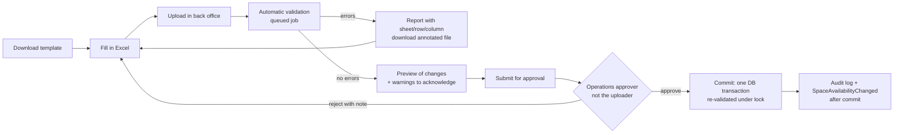

# SmartGro — Inventory Import Template and Validation Process

| | |
|---|---|
| Status | **v1.0-rc — Phase 1, ready for owner review** (approval tracked as D-35). The importer itself is built in Phase 5. |
| Last updated | 2026-10-24 |
| Template | [`docs/templates/inventory-import/SmartGro_Inventory_Import_Template_SG-INV-1.0.xlsx`](../templates/inventory-import/SmartGro_Inventory_Import_Template_SG-INV-1.0.xlsx) (template ID `SG-INV-1.0`) |
| Synthetic fixtures | [`tests/Fixtures/Inventory/SYNTHETIC_inventory_valid.xlsx`](../../tests/Fixtures/Inventory/SYNTHETIC_inventory_valid.xlsx) · [`tests/Fixtures/Inventory/SYNTHETIC_inventory_with_errors.xlsx`](../../tests/Fixtures/Inventory/SYNTHETIC_inventory_with_errors.xlsx) |
| Depends on | D-02 locations, D-03 product catalogue (space types), D-05 seat tracking, D-06 existing systems (which may replace spreadsheet import with a sync) |

---

## 1. Purpose

The client will send the first real location's inventory as a spreadsheet. This template gives operations staff:
* a structured, validated way to record the **physical truth** (BR-SOT-1)
* no need for database, JSON or technical knowledge

The same template is later downloadable from the back office for every new location and every bulk update.

**Out of scope for SG-INV-1.0:** prices (D-04), marketing copy, photos and 3D models. Each has its own workflow.

---

## 2. Workbook structure

| Sheet | One row per | Key (must be unique) | Notes |
|---|---|---|---|
| Read me | — | — | instructions, colour legend, process |
| Location | SmartGro centre | `location_code` | address, coordinates, status, opening date, time zone, centre manager (staff email) |
| Hours | location × weekday | (`location_code`, `day_of_week`) | 7 rows per location |
| Floors | operated floor | (`location_code`, `building_level`) | optional floor-plan file name |
| Spaces | physical workspace | `space_code` (globally unique, permanent) | type, capacity, area, status, listability, seat tracking, amenities, booking limits |
| Seats | seat in a per-seat desk zone | (`space_code`, `seat_label`) | only if D-05 = per-seat |
| Occupancy | long-term agreement on a space or seat | (`contract_reference`, `space_code`, `seat_label`, `starts_on`) | **no personal data**: an internal agreement number only |
| Amenities | amenity name | `amenity_name` | controlled vocabulary referenced from Spaces |
| Lists (hidden) | — | — | dropdown values (named ranges) |
| `_meta` (very hidden) | — | — | `template_id`, `workbook_kind`, `first_data_row` |

**Layout of every data sheet**

| Row | Content | Treatment by the importer |
|---|---|---|
| 1 | machine column keys (green header = required, grey = optional) | must match exactly (V-003) |
| 2 | help text | ignored |
| 3 | grey **EXAMPLE** row (synthetic `SYN-EXAMPLE` values) | always ignored |
| 4+ | data (yellow input cells) | imported |

Dropdown values are human labels (e.g. "Private office"). The importer maps labels to stored keys case-insensitively and also accepts the keys themselves (e.g. `private_office`).

| Label | Stored key | Booking mode (derived; ERD §3) |
|---|---|---|
| Private office | `private_office` | contract |
| Managed suite | `managed_suite` | contract |
| Dedicated desk zone | `dedicated_desk_zone` | contract (per seat or pooled, D-05) |
| Hot desk zone | `hot_desk_zone` | shared_capacity |
| Meeting room · Board room · Event space · Phone booth · Training room | `meeting_room` · `board_room` · `event_space` · `phone_booth` · `training_room` | exclusive_slot |

The space-type list is **provisional** until the client confirms its product catalogue (D-03).

---

## 3. Process

| Step | Rule |
|---|---|
| Upload | Requires `inventory.import` permission. XLSX only, at most 10 MB and 20,000 data rows. The file is stored privately with its SHA-256 checksum. A duplicate checksum shows "this exact file was already imported on …". |
| Validation | Runs as a queued, idempotent job in the stages of §4. **Rows that fail a field-level or reference rule are excluded from aggregate checks** (e.g. over-allocation), so one mistake produces one clear message, not a cascade. |
| Report | In plain language: sheet, row, column, the value found, the rule, and how to fix it. Downloadable as the original workbook with problem cells highlighted and a comment on each. |
| Preview | Counts of new, updated, unchanged and "not in file" records per sheet; field-level before/after for updates; an **availability impact** summary (e.g. "2 spaces will stop being bookable"). |
| Warnings | Never block, but each must be acknowledged by the uploader. Acknowledgements are stored with the import. |
| Approval | `inventory.import.approve`, held by someone **other than the uploader** [DEFAULT, four-eyes; mirrors BR-PR-2]. |
| Commit | All-or-nothing in one transaction. Affected `spaces` rows are locked (ADR-0004) so bookings cannot race the import. All checks are re-run inside the transaction against current data. If anything changed since the preview, the commit aborts and asks for re-validation. |
| After commit | Audit entry per created or updated record. `SpaceAvailabilityChanged` is fired for every affected space after commit. The import record keeps the file, report, approver and timestamps. |
| Idempotency | Upserts by natural keys. Re-importing the same content changes nothing. |
| Deletion | **Never automatic.** Records missing from a re-upload appear as "Not in file — no change". Decommissioning is an explicit operational action. |
| Reversal | No automatic undo. Corrections come through a new import or individual edits, all audited. |

---

## 4. Validation rules

Severity: **E** = error (blocks commit) · **W** = warning (must be acknowledged).

### 4.1 Structure

| Rule | Sev | Check |
|---|---|---|
| V-001 | E | `_meta.template_id` is a supported version (`SG-INV-1.x`) |
| V-002 | E | all required sheets present with unchanged names. Sheets starting with `_` are reserved and ignored. |
| V-003 | E | row 1 of each sheet contains every expected key. Unknown extra columns produce a warning and are ignored. |
| V-004 | E | file type, size and row limits (§3) |
| V-005 | E | no cell holds a formula without a cached value, and no external workbook links |

### 4.2 Field level

| Rule | Sev | Check |
|---|---|---|
| V-101 | E | required value missing |
| V-102 | E | codes are 2–40 characters matching `^[A-Z0-9][A-Z0-9-]{0,38}[A-Z0-9]$` after trimming: capitals, digits and inner hyphens. Lowercase is auto-uppercased **with a note**. Spaces and symbols are errors. |
| V-103 | E | text length limits (names 120, addresses 190, notes 1,000, contract reference 60) |
| V-104 | E | dates are real dates (ISO `YYYY-MM-DD` or an Excel date) between 2000-01-01 and 2099-12-31 |
| V-105 | E | list values are one of the allowed labels or keys |
| V-106 | E | Yes/No fields contain Yes or No |
| V-107 | E | times are 24-hour `HH:MM` (text or Excel time) |
| V-108 | E | `country_code` is ISO 3166-1 alpha-2. `timezone` is a valid IANA zone (blank → `Asia/Kolkata`, assumption A-1). |
| V-109 | E | latitude −90…90 and longitude −180…180. Both or neither. |
| V-110 | E | numeric ranges: capacity 1–2,000 (whole); area 1–1,000,000; building level −5…200; minutes 0–1,440 |
| V-111 | W | `centre_manager_email` is a valid email that matches an active staff user. If not, the location is created without a manager. |
| V-112 | E | Hours: `closes_at` is after `opens_at` when open; times are blank when `is_closed = Yes` |
| V-113 | W | postal code format per country (IN: six digits, first digit 1–9) |
| V-114 | W | each location has exactly 7 Hours rows. Missing days are treated as closed. |
| V-115 | E | bookable room types need `min_booking_minutes` ≤ `max_booking_minutes`. A blank turnaround becomes 0. |
| V-116 | E | `seat_tracking` is required for desk zones and must be blank for every other type |

### 4.3 Uniqueness and references

| Rule | Sev | Check |
|---|---|---|
| V-120 | E | keys in §2 are unique within the file |
| V-121 | E | a `space_code` or `location_code` already in the database belongs to the same location (codes are permanent and are never moved) |
| V-122 | W | an update changes an identity field of an existing location (city, building, address). This needs explicit confirmation in the preview. |
| V-130 | E | each space's (`location_code`, `building_level`) exists on the Floors sheet or in the database |
| V-131 | E | every `location_code` on Hours, Floors and Spaces exists on the Location sheet or in the database |
| V-135 | E | Seats rows only for desk zones with `seat_tracking = Per seat`. The number of active seats equals `capacity_seats`. |

### 4.4 Occupancy and business rules

| Rule | Sev | Check |
|---|---|---|
| V-140 | E | `ends_on` ≥ `starts_on`; `notice_given_on` ≤ `ends_on`. Status agrees with the dates: Notice period needs both `notice_given_on` and `ends_on`; Ended needs an `ends_on` in the past; Active needs `starts_on` ≤ today. |
| V-145 | E | `seat_label` only for per-seat zones, and it must exist on Seats or in the database |
| V-150 | E | **No over-allocation:** for every date, the seats in blocking agreements (Reserved, Active, Notice period) on a space must not exceed `capacity_seats`. A per-seat seat holds one agreement at a time (BR-AV-3). |
| V-151 | E | Occupancy rows only for contract spaces (offices, suites, desk zones). Rooms are booked, not allocated. |
| V-152 | W | an agreement on a space in Maintenance, Out of service or Decommissioned |
| W-160 | W | an amenity on Spaces that is not on the Amenities sheet or in the database vocabulary (with a "did you mean" suggestion) |
| W-161 | W | a Planned or Pre-opening location with Active, publicly listable spaces. They will not be bookable (BR-AV-6). |
| W-162 | W | area per seat below 20 sq ft or above 500 sq ft (a likely typing error) |

### 4.5 Privacy and environment

| Rule | Sev | Check |
|---|---|---|
| W-170 | W | personal data patterns (email address, phone number) found in free-text fields (`contract_reference`, `notes`). The uploader must remove it or justify it. |
| V-180 | E | **Synthetic-data guard:** codes beginning `SYN-` or names containing "SYNTHETIC" are rejected in any environment other than `local` and `testing` |

---

## 5. Data model additions (ERD)

| Table | Key columns |
|---|---|
| `inventory_imports` | `uploaded_by`, `file_path` (private disk), `file_sha256`, `template_id`, `status` (`uploaded`, `validating`, `invalid`, `valid`, `awaiting_approval`, `approved`, `committing`, `committed`, `rejected`, `failed`), `summary` (counts), `warnings_acknowledged_by/at`, `approved_by/at`, `committed_at`, `environment` |
| `inventory_import_issues` | `inventory_import_id`, `sheet`, `row`, `column`, `rule`, `severity`, `message`, `value_excerpt` (truncated; personal data masked) |

Both are added to `../architecture/DATABASE_ERD.md` §3.

---

## 6. Technology (proposed; requires approval with D-24)

* **Reading XLSX:** `openspout/openspout` 4.32.0 is already installed as a Filament dependency (verified with `composer show`, 2026-10-24). It streams large files with low memory use. It would be declared as a **direct** dependency, so the importer does not rely on a transitive package.
* **Why not Filament's built-in CSV importer:** it imports one entity per CSV. This import is relational across several sheets, all-or-nothing, and needs an approval step. Filament provides the **UI** (upload, report, preview, approval pages); a domain action (`Inventory\ImportInventoryWorkbook`) does the work.
* **CSV fallback:** deferred. Excel is the format operations teams use, and the template's dropdowns only work in XLSX.

---

## 7. Synthetic test fixtures

| File | Content | Purpose |
|---|---|---|
| `SYNTHETIC_inventory_valid.xlsx` | 2 fictional locations ("SYNTHETIC Centre Alpha/Beta", city "Synthville", codes `SYN-*`), 14 hour rows, 4 floors, 15 spaces covering every type and status, 12 seats, 7 agreements (active, reserved, notice period, per seat), 6 amenities | must validate with **zero errors and zero warnings** |
| `SYNTHETIC_inventory_with_errors.xlsx` | the valid data plus deliberately broken rows; a hidden `_expected_issues` sheet lists 15 expected issues (sheet, row, column, rule, severity) covering V-101, V-102, V-105, V-110, V-112, V-115, V-120, V-130, V-135, V-140, V-145, V-150, W-160, W-170 | the validator must report **exactly** these issues |

Fixture test conditions:
* time frozen at **2026-10-24**, because status and date rules depend on "today"
* a staff user `synthetic.manager@example.com` seeded by factory, so V-111 does not warn
* V-150 is reported on the agreement row, in file order, at which the running total first exceeds capacity. Duplicates (V-120) are reported on the later occurrence.

Rules for synthetic data:
1. It is fictional: no real addresses, no coordinates, no real company or person names. `example.com` emails only.
2. Every synthetic workbook carries a red "SYNTHETIC TEST DATA" banner and `_meta.workbook_kind = synthetic-*`.
3. V-180 prevents synthetic codes from ever being imported outside local or testing environments.
4. Real client spreadsheets are **never** committed to Git or used as test fixtures. They are uploaded only through the back office.

Generated 2026-10-24 with openpyxl 3.1.5. Structure verified on read-back: sheets, headers, validations and named ranges present; no formulas; the valid file was also rendered through LibreOffice for a visual check.
